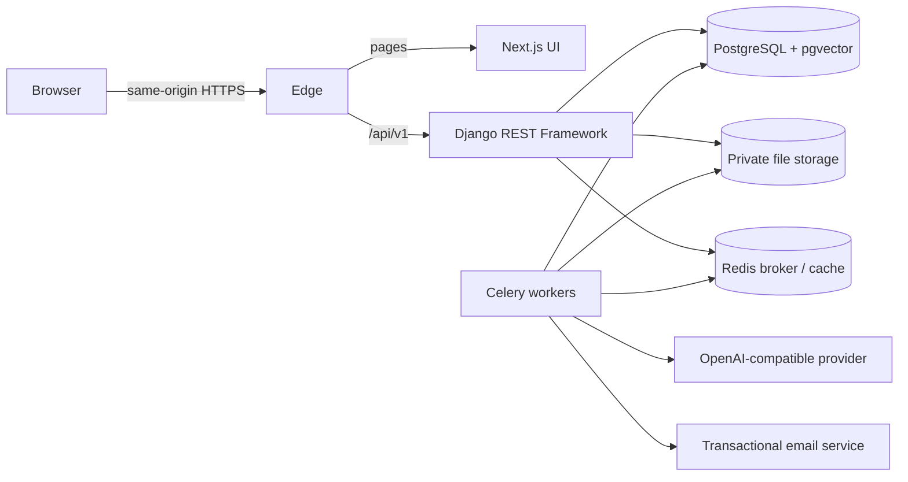

# IDROK AI — Architecture

Status: proposed; approval required before implementation. See [PRD](PRD.md) and [API contract](api-contract.yaml).

## Architectural decision

Use an API-first modular monolith: Django REST Framework owns domain rules and PostgreSQL persistence; Next.js with TypeScript and Tailwind CSS consumes the versioned HTTP contract. Celery runs durable asynchronous workloads using Redis as broker. PostgreSQL with pgvector stores tenant knowledge embeddings. Private file storage is an additional infrastructure dependency: filesystem volume for local development and an S3-compatible private bucket for production. Provider credentials remain server-side.

This minimizes distributed-system overhead while preserving explicit module boundaries. Extract services only when measured scaling or ownership needs justify them. No backend/frontend implementation, dependency installation, or deployment is part of this architecture phase.



## Module boundaries

| Module | Ownership |
| --- | --- |
| identity | Users, verified email, server-side sessions, invitation acceptance |
| tenancy | Companies, memberships, role checks, enabled modules, tenant context |
| crm | Contacts and archive state |
| work | Tasks, assignees, status transitions |
| knowledge | Documents, versions, chunks, embeddings, ingestion lifecycle |
| assistant | Conversations, messages, runs, retrieval, citations, provider adapter |
| operations | Audit events, usage ledger, quotas, outbox and job recovery |
| industries (later) | Separately enabled clinic, education, retail, hospitality domains |

Modules call explicit application services; views and tasks do not bypass authorization. Shared code is limited to identifiers, error types, tenancy primitives, and observability. Industry entities reference core contacts through validated tenant relationships; do not turn the core into an unrestricted JSON entity system. Industry modules own their models, permissions, routes, migrations, and tests.

## Planned repository organization

These directories are a proposal, not folders created in this phase:

```text
backend/config/              Django settings, routing, Celery setup
backend/apps/{identity,tenancy,crm,work,knowledge,assistant,operations}/
frontend/src/{app,features,components,lib}/
frontend/src/lib/api/         Generated contract types and HTTP client
infra/                       Docker and environment templates
docs/                        PRD, architecture, API contract
```

## Tenant isolation and data model

Use one PostgreSQL database/shared schema initially. Each company-owned table has a non-null company_id, UUID primary key, timestamps, and suitable compound indexes starting with company_id. Global tables are users and server-side session/verification records. Membership joins user and company uniquely; invitations are tenant-owned.

All company APIs have `/companies/{company_id}/...` paths. Path selection is untrusted: authenticate, verify active membership and role, set transaction-local tenant context, then access data. Company IDs from request bodies are forbidden. Derive company_id server-side. Foreign IDs (contact, assignee, conversation, source document) must belong to that company. Return 404 for inaccessible tenant resources. Never authorize from a frontend company switcher or cached role alone.

Use explicit company-scoped ORM access plus PostgreSQL row-level security as defense in depth for tenant-owned tables. Migrations use a separate database owner. Runtime API/worker roles must not own tables or have BYPASSRLS; enable and force RLS. Policies fail closed without transaction-local company context. Global membership lookup is a narrowly scoped authorization operation restricted by authenticated user ID; it must not create a broad RLS bypass. All pooled connections reset context at transaction end. Integration tests exercise real runtime roles and missing context.

Worker payloads contain company_id and job ID; workers establish the same context, reload the job, and revalidate actor membership for user-initiated work before processing or delivering results. Internal maintenance jobs use explicit audited service identity and company scope. Cache keys, storage prefixes, queue deduplication keys, and rate limits include company_id. Private files have no public permanent URLs; downloads, if added, require current authorization and short-lived scoped access.

Key relations: Company → Membership/Invitation/Contact/Task/Document/Conversation/AuditEvent/UsageEvent; Document → Chunk; Conversation → Message/AssistantRun; AssistantRun → citations referencing immutable document version and chunk IDs. A task optionally references a contact and assignee membership. Enforce tenant consistency with compound constraints where possible, plus service validation. Use a unique owner-preservation transaction/lock to prevent concurrent removal of all owners.

## Authentication and API conventions

Use Django server-side sessions via Secure, HttpOnly, SameSite=Lax cookies behind a same-origin reverse proxy. `/auth/csrf` bootstraps CSRF; unsafe requests including login require X-CSRFToken and origin validation. Rotate session at login; logout invalidates it. No tokens in localStorage. Next.js server-side requests explicitly forward the session only to the trusted API and disable caching for authenticated company data. Cross-origin deployment is outside the MVP topology.

Use `/api/v1`, JSON, UUIDs, UTC RFC3339 timestamps, ISO date filters, bounded limit/offset pagination, and structured errors with request_id. Validate all inputs and disallow unknown fields. PATCH updates are partial. GET is side-effect free. Use 401 for unauthenticated, 403 for insufficient role within a visible company, 404 for inaccessible records, 409 for conflicts, 413 for oversized upload, 415 for unsupported type, 429 for throttling/quotas, and 503 for unavailable dependencies. Never return stack traces. OpenAPI is the source of truth; schema generation and breaking-change checks are future CI gates.

## Asynchronous execution and consistency

Document upload and assistant messages create persisted jobs and return 202 with a polling URL. Persist records and an outbox event in one database transaction; a dispatcher publishes to Celery and marks delivery. A scheduled recovery loop republishes undelivered events and marks deadline-expired jobs failed. Redis is not the authoritative job store. Celery delivery is at least once; handlers use durable status transitions and leases, with bounded retries/backoff only for transient failures. Poison jobs become failed with a safe error code. Separate ingestion, assistant, and email queues prevent ingestion from starving chat.

Require Idempotency-Key for company creation, invitations, uploads, and message submission. Scope stored keys by authenticated user, company (when present), route, and body hash for 24 hours. Replay the original response for the same request; return 409 for changed payloads or an in-progress duplicate. Enforce unique constraints in PostgreSQL. Async retries use the original job ID. Provider timeout may have incurred charges: do not blindly repeat ambiguous completions; mark failed/unknown and reconcile usage conservatively.

## RAG and provider boundary

1. Validate upload extension, actual MIME, size, and parser limits; quarantine bytes until scanning/validation completes. No arbitrary URL ingestion or remote-resource fetching.
2. Extract text in a bounded worker, normalize, chunk, and compute embeddings through a configurable provider adapter. Store embedding model and dimension with each version; incompatible model changes require a separately built index and atomic activation.
3. Publish chunks only when the whole version succeeds. Failed/removed documents are never searchable. Removal immediately hides chunks, then asynchronously erases files/vectors and invalidates caches.
4. For a message, enforce company budgets and current membership, retrieve within company and active document versions, and send a bounded amount of context to the provider. MVP knowledge is readable by all active company members.
5. Treat retrieved text as untrusted data. System instructions prohibit following document instructions or invoking tools. Answers include server-validated citation IDs and short excerpts; no fabricated source links. Recheck document visibility at result read time and suppress removed citations/content as necessary.
6. Persist terminal answer/failed state, model identifier, tokens, duration, and usage reservation settlement. Low-evidence queries abstain. AI only answers knowledge questions; CRUD remains explicit user-controlled API actions.

The provider adapter isolates completion, embedding, timeout, error translation, and usage handling; OpenAI compatibility is an interface assumption requiring capability checks. Select provider and models after approval. No model choice, pricing, or current third-party capability is asserted here.

## Security, reliability, and operations

Apply TLS, encrypted storage/backups, secret injection, restricted CORS/origins, upload scanning, dependency scanning, and tenant/user rate limits. Reserve AI quota transactionally before queueing to prevent concurrent budget overruns; finalize actual or conservative estimated usage on every terminal path. Log metadata with request/job/company IDs, redact PII and secrets, and audit membership, knowledge, contact, and task mutations. Audit events are append-only to application roles; privileged database access remains an operational trust boundary.

PostgreSQL is authoritative; Redis cache loss is tolerable. Backups include database and private objects with a consistent recovery procedure. Track CRUD latency/error rate, queue age, job failure rate, AI latency/cost, ingestion failures, and denied tenant access. Use liveness/readiness checks without secrets; database/worker readiness gates rollout. Docker services proposed: edge, frontend, API, worker(s), scheduler/outbox dispatcher, PostgreSQL, Redis, and local private storage. Production topology and deployment remain unapproved.

Apply the PRD's provisional deletion/backup retention policy only after owner confirmation. Company deletion/export and billing self-service are deferred; pilot deletion requests use an authenticated, audited operator procedure with explicit company scope. Do not onboard regulated sensitive records until requirements and hosting decisions are assessed.

## Verification and evolution

Future tests cover domain state changes, authentication/CSRF, every role, RLS under runtime DB roles, cross-company foreign IDs, cache/storage isolation, retries/outbox recovery, duplicate requests, removed citations, upload abuse, quotas, and RAG evaluation. Contract lint and backend/frontend conformance must pass before release. Implement in the PRD sequence. Later introduce industry modules, integrations, workflow actions with explicit approval policies, then billing. Avoid microservices and separate vector infrastructure until evidence requires them.

## Discovery limitation

Local repository inspection was blocked by process-runner initialization failure. Reconcile this proposed layout and policy with existing files before implementation; do not assume existing code meets these rules.
