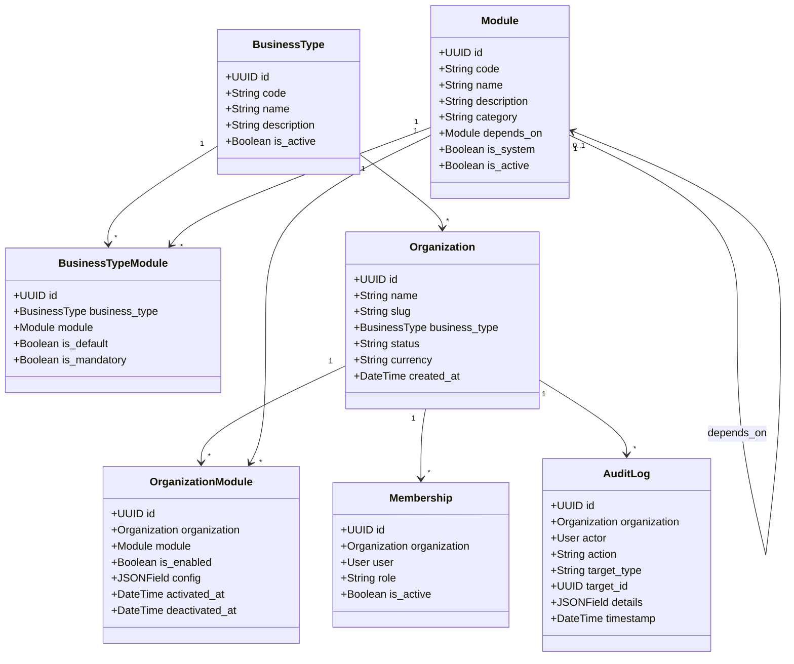

# IDROK AI — System Architecture Specification

**Status:** Proposed Architecture  
**Role:** Principal Software Architect & Backend Lead  
**Backend:** Django 5.1+ & Django REST Framework (Python 3.12+)  
**Frontend:** Next.js 14+ (App Router, TypeScript, Tailwind CSS)  
**Database:** SQLite3 (Local Dev & First MVP) → PostgreSQL 16+ (Multi-Tenant Production)  
**Architecture Style:** API-First Modular Monolith with Dynamic Database-Driven Feature Activation  

---

## 1. Dual Administration Topology

A central architectural requirement of IDROK AI is the strict separation between the **Platform Super Admin** and the **Tenant Business Dashboard**:

```mermaid
flowchart TD
  subgraph Platform Administrators
    SuperAdminUser[Platform Super Admin\nBrowser Session]
  end

  subgraph Tenant Users
    BusinessUser[Shop Owners, Managers, Cashiers,\nTeachers, Students, Accountants]
  end

  subgraph Experience 1: Platform Super Admin [Django Backend]
    DjangoAdmin[Customized Django Admin UI\n/platform-admin/ or /admin/\n• Organization Provisioning\n• BusinessType Management\n• Module Catalog & Dependencies\n• Tenant Module Toggles\n• System-wide Audit Logs\n• Platform Analytics]
  end

  subgraph Experience 2: Business Dashboard [Next.js Frontend]
    NextApp[Next.js 14+ Web Application\n• Dynamic Navigation based on enabled modules\n• Retail POS / Cashier View\n• Retail Customer Debts & Ledgers\n• Education LMS / Classes / Tuitions\n• Role-governed Dashboard Views]
  end

  subgraph API Gateway & Security
    Proxy[Reverse Proxy / Nginx]
    TenantAuth[DRF Authentication & Session Validator]
    TenantCtx[TenantContextMiddleware\nEnforces Organization Scope]
    ModuleGuard[RequiresModule Permission Class\nValidates OrganizationModule Activation]
  end

  subgraph Modular Monolith Backend [Django REST Framework]
    CoreApps[Core Apps:\nidentity, tenancy, platform_admin, operations]
    RetailModules[Retail Modules:\nretail_customers, retail_debts, retail_inventory, retail_pos]
    EduModules[Education Modules:\nedu_students, edu_groups, edu_tuition, edu_lms]
    AtomicLayer[transaction.atomic()\nDouble-Entry Ledgers & Idempotency Engine]
  end

  subgraph Persistence Layer
    SQLite[(SQLite3 Database\nWAL Mode + 5s Busy Timeout)]
    PGMigration[Planned PostgreSQL Migration Gate\nRow-Level Locking + RLS + PgBouncer]
  end

  SuperAdminUser -->|Direct Admin Session| DjangoAdmin
  DjangoAdmin --> CoreApps
  CoreApps --> SQLite

  BusinessUser -->|HTTPS| NextApp
  NextApp -->|REST /api/v1/*| Proxy
  Proxy --> TenantAuth
  TenantAuth --> TenantCtx
  TenantCtx --> ModuleGuard
  ModuleGuard --> RetailModules
  ModuleGuard --> EduModules
  RetailModules --> AtomicLayer
  EduModules --> AtomicLayer
  AtomicLayer --> SQLite
  SQLite -.->|Schema-compatible cutover| PGMigration
```

### 1.1 Architecture Separation Breakdown

| Dimension | Experience 1: Platform Super Admin | Experience 2: Tenant Business Dashboard |
| --- | --- | --- |
| **Location** | Embedded in Django Backend (`/admin/`) | Separate Next.js Frontend (`frontend/`) |
| **Access Control** | Restricted to `User.is_platform_super_admin = True` | Authenticated users with active `Membership` in tenant organization |
| **Communication** | Direct Django template rendering (Django Admin customized) | Exclusively via versioned HTTP REST APIs (`/api/v1/*`) |
| **Scope of View** | Cross-tenant: all organizations, all modules, global audit logs | Strictly single-tenant: data filtered to active `organization_id` |
| **Feature Visibility** | Full catalog of business types, modules, and subscriptions | Dynamic: UI renders **only** the modules activated for that organization |
| **Data Ingress** | Platform settings, module definitions, organization onboarding | Day-to-day operations: debts, sales, students, homework, payments |

---

## 2. Modular Feature Management Architecture

Rather than compiling dynamic or unverified external plugins at runtime, IDROK AI utilizes registered Django applications governed by database-controlled entitlement records. This guarantees type safety, declarative migrations, and zero security vulnerabilities from arbitrary code execution.



### 2.1 Module Lifecycle and Enforcement Flow

1. **System Registration:** Every module is implemented as a cohesive Django app inside `backend/apps/modules/` with a unique immutable code (e.g. `retail_debts`, `edu_tuition`).
2. **Catalog Definition:** Super Admins register the module in the database table `Module`, defining its parent dependency (if any).
3. **Template Association:** In `BusinessTypeModule`, the module is mapped to business types as `mandatory`, `default`, or `optional`.
4. **Tenant Activation:** When an organization is created, default modules for its `BusinessType` are automatically created in `OrganizationModule` with `is_enabled=True`.
5. **Runtime Enforcement:**
   - Every API endpoint is decorated or protected by the permission class `RequiresModule('module_code')`.
   - The permission checks `OrganizationModule.objects.filter(organization=request.organization, module__code=module_code, is_enabled=True).exists()`.
   - If disabled, the request is immediately rejected with HTTP `403 Forbidden` (`code: MODULE_DISABLED`).
6. **Data Preservation Guarantee:**
   - When an administrator disables a module for an organization, **no database records, tables, or relations are dropped**.
   - Only API access and automated scheduled tasks for that module are suspended.
   - If the module is re-enabled in the future, all historical debts, customer profiles, lesson materials, and audit history are immediately available.
7. **Scheduled Job & Background Task Safety:**
   - Background workers (Celery/Cron) handling recurring jobs (e.g., debt reminder SMS, student tuition invoices) verify that `OrganizationModule.is_enabled` is True before processing the job.
   - If the module is suspended, the job is cleanly skipped with an audit log entry.

---

## 3. Platform Super Admin Customization (Django Admin)

The Platform Super Admin console is constructed inside Django Admin with custom views, admin forms, and action handlers:

### 3.1 Organization Detail Interface (`OrganizationAdmin`)
When a Super Admin opens an organization in Django Admin, the screen displays:
1. **Organization Profile Card:** Name, slug, business type badge, creation date, status toggle (`active`, `suspended`, `pending_verification`).
2. **Business Type & Currency:** Target industry and monetary currency.
3. **Owner & Staff Directory:** Primary organization owner contact, active employee list with roles (`org_owner`, `org_manager`, `cashier`, `teacher`, etc.).
4. **Interactive Module Matrix:**
   - Visual grid of **Enabled Modules** (with green activation indicators and toggle buttons).
   - Visual grid of **Disabled / Available Modules** (with one-click activation).
   - **Dependency Warning Modal:** If an admin attempts to deactivate a module that other active modules depend on (e.g. disabling `retail_customers` while `retail_debts` is active), the admin interface prevents the action and displays a dependency conflict warning.
5. **Usage & Financial Summary:** Total active customers/students, total ledger transaction volume, storage utilization.
6. **Immutable Audit Trail Tab:** Chronological timeline of all administrative changes made to this organization.

### 3.2 Platform-Wide Management Actions
- **Bulk Organization Management:** Bulk suspend/activate organizations with required reason confirmation.
- **BusinessType Module Sync:** Propagate new module defaults to existing organizations of that business type with an audited confirmation workflow.
- **Tenant Isolation Guarantee in Admin:** Super Admin views use explicit organization filtering. Administrative queries never mix or aggregate tenant operational records into public scopes.

---

## 4. Financial Safety and SQLite3 Concurrency Design

Because IDROK AI manages business debt, customer store credit, and student tuition billing, financial integrity is non-negotiable.

### 4.1 Monetary Precision Standards
- All monetary amounts (debts, repayments, tuition invoices, student balances, credit limits) strictly use `models.DecimalField(max_digits=12, decimal_places=2)`.
- Floating-point numbers (`FloatField`, JS `Number`) are strictly forbidden in business logic, serializers, and calculations. In JSON contracts, amounts are transmitted as formatted decimal strings (e.g. `"150000.00"`).

### 4.2 SQLite3 Concurrency Without `select_for_update()`
SQLite3 relies on database-level file locks and does not support PostgreSQL row-level locks (`SELECT ... FOR UPDATE`). Concurrency safety is achieved via:
1. **Atomic Transaction Scope:** All balance mutations execute inside `transaction.atomic()`. Operations are kept minimal to minimize lock hold duration.
2. **WAL Mode and Busy Timeout:**
   - `PRAGMA journal_mode = WAL;` (allows concurrent readers while one writer is writing).
   - `PRAGMA busy_timeout = 5000;` (SQLite will automatically retry locked writes for up to 5 seconds before failing).
   - `PRAGMA synchronous = NORMAL;`.
3. **Idempotent Payment Processing:**
   - Every payment, debt creation, or invoice generation endpoint requires an `Idempotency-Key` header (UUIDv4).
   - Duplicate submissions within 24 hours return the original response payload without executing duplicate balance mutations.
4. **Double-Entry Ledger Pattern:**
   - Balance changes write immutable ledger entries (`DebtLedger`, `TuitionLedger`).
   - Customer and student balances are atomically updated using Django `models.F()` expressions or strict delta validations inside `transaction.atomic()`.

---

## 5. PostgreSQL Production Migration Plan

Prior to opening the platform to high-concurrency multi-user production, the database will be migrated from SQLite3 to PostgreSQL 16+.

### 5.1 Architecture Readiness (Built Today)
- 100% database-agnostic models: no SQLite-specific or PostgreSQL-specific extensions in application code.
- Foreign keys, unique constraints, and check constraints defined in Django ORM.
- Compound indexes configured on `(organization_id, ...)` across all tenant tables.

### 5.2 Migration Execution Steps
1. **Infrastructure Provisioning:** Deploy managed PostgreSQL 16+ instance with SSL.
2. **Schema Migration:** Apply standard Django migrations (`python manage.py migrate --database=production`).
3. **Data Transfer:**
   - Serialized data transfer via Django `dumpdata`/`loaddata` or `pgloader` with automated table mappings.
4. **Activate PostgreSQL Concurrency Controls:**
   - Enable `select_for_update()` row-level locks on `DebtCustomer`, `Student`, and `Organization` balance rows in application services.
   - Deploy PgBouncer for high-throughput connection pooling.
5. **Activate PostgreSQL Row-Level Security (RLS):**
   - Apply PostgreSQL RLS policies on all tenant tables (`organization_id = current_setting('app.current_org_id')`) as defense-in-depth behind application middleware.

---

## 6. Target Repository Organization

```text
idrokai/
├── docs/                                  Shared architectural specifications
│   ├── PRD.md                             Product requirements & release gates
│   ├── architecture.md                    This architecture specification
│   ├── database-schema.md                 Detailed Entity-Relationship schemas
│   ├── module-system.md                   Modular feature activation mechanics
│   ├── roles-permissions.md               RBAC and security boundaries
│   ├── api-contract.yaml                  OpenAPI 3.1 REST API specification
│   └── development-roadmap.md             Phased implementation roadmap
├── backend/                               Django REST Framework Modular Monolith
│   ├── manage.py
│   ├── config/                            Project configuration & settings
│   │   ├── settings/                      base.py, local.py, test.py, prod.py
│   │   ├── urls.py                        Main URL router
│   │   ├── wsgi.py / asgi.py
│   └── apps/
│       ├── common/                        Base models, exception handlers, utils
│       ├── identity/                      User model, authentication, sessions
│       ├── tenancy/                       Organization, BusinessType, Membership
│       ├── platform_admin/                Customized Django Super Admin UI & views
│       ├── operations/                    AuditLog, IdempotencyRecord
│       └── modules/                       Registered feature modules
│           ├── retail_customers/          Retail debtor customer directory
│           ├── retail_debts/              Retail debt ledger & repayments
│           ├── retail_inventory/          (Phase 5) Inventory & SKUs
│           ├── retail_pos/                (Phase 5) POS sales counter
│           ├── edu_students/              (Phase 6) Student management
│           ├── edu_groups/                (Phase 6) Study cohorts & rooms
│           ├── edu_tuition/               (Phase 6) Tuition billing & fee debts
│           └── edu_lms/                   (Phase 7) Video lessons & homework
├── frontend/                              Next.js 14+ Business Dashboard
│   ├── package.json
│   ├── tsconfig.json
│   ├── tailwind.config.ts
│   └── src/
│       ├── app/                           App Router routes
│       │   ├── (auth)/login/              Business login
│       │   └── (dashboard)/               Dynamic tenant dashboard
│       │       ├── debts/                 Retail debt management & POS
│       │       ├── customers/             Retail customer directory
│       │       ├── students/              (Phase 6) Education students
│       │       ├── groups/                (Phase 6) Education cohorts
│       │       └── reports/               Financial & operational reports
│       ├── components/                    Reusable UI components
│       └── lib/
│           ├── api/                       API client, types, module guards
│           └── hooks/                     useOrganizationModules hook
├── AGENTS.md                              Codex & Antigravity collaboration rules
└── README.md                              Project overview & quickstart
```
