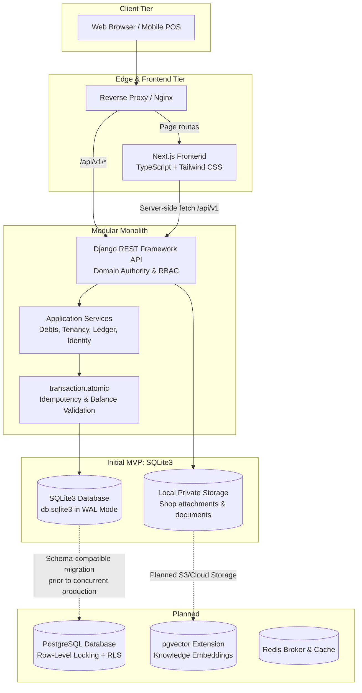
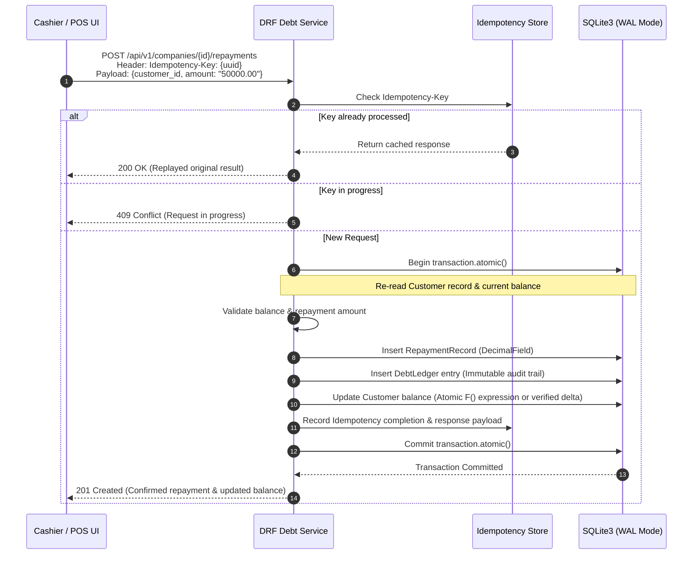

# IDROK AI — Architecture Specification

Status: Proposed Architecture Update; awaiting owner approval.  
See: [PRD](PRD.md) and [API Contract](api-contract.yaml).  
Initial Database: **SQLite3 (Local Development & First MVP)**  
Target Production Database: **PostgreSQL (Planned Pre-Production Migration)**  
First Business Module: **Shop Debt Management (Nasiya Savdo)**

---

## 1. Architectural Overview

IDROK AI is an API-first modular monolith designed to deliver robust, multi-tenant business automation with minimal operational complexity. 

The architecture strictly separates the backend domain authority and the frontend user interface:
- **Backend**: Django REST Framework (DRF) running Python 3.12+, acting as the single domain authority, business rule engine, and transaction coordinator.
- **Frontend**: Next.js 14+ (App Router, TypeScript, Tailwind CSS), consuming the versioned `/api/v1` HTTP contract with server-side session forwarding.
- **Initial Database**: **SQLite3** configured as the default database for local development and the initial MVP release.
- **Production Target Database**: **PostgreSQL** (with row-level locking and pgvector), scheduled for migration prior to multi-user production deployment.



---

## 2. Database Strategy & SQLite3 Technical Requirements

### 2.1 Default Database Configuration
The Django settings strictly configure SQLite3 as the default database for local development and the initial MVP:

```python
# backend/config/settings/base.py
DATABASES = {
    'default': {
        'ENGINE': 'django.db.backends.sqlite3',
        'NAME': BASE_DIR / 'db.sqlite3',
        'OPTIONS': {
            'timeout': 20,  # 20-second busy timeout for write lock contention
        },
    }
}
```

PostgreSQL is **not** configured or initialized in this phase.

### 2.2 SQLite3 Optimization: WAL Mode and Pragma Settings
By default, SQLite uses rollback journal mode, where any write locks the entire database file against all readers and writers. To optimize concurrency for the MVP, the connection is configured with **Write-Ahead Logging (WAL)**:

```python
# backend/config/db_init.py (connected via connection_created signal)
from django.db.backends.signals import connection_created
from django.dispatch import receiver

@receiver(connection_created)
def configure_sqlite_pragmas(sender, connection, **kwargs):
    if connection.vendor == 'sqlite':
        cursor = connection.cursor()
        cursor.execute('PRAGMA journal_mode = WAL;')
        cursor.execute('PRAGMA busy_timeout = 5000;')  # 5 seconds
        cursor.execute('PRAGMA synchronous = NORMAL;')
        cursor.execute('PRAGMA foreign_keys = ON;')
```

**Benefits in MVP**:
- Readers do not block writers, and writers do not block readers.
- Greatly reduces `database is locked` errors during cashier and management workflows.

### 2.3 SQLite3 Write-Concurrency Limitations (Documented Risk)
1. **Single-Writer Constraint**: SQLite only supports one active write transaction at a time across the entire database file. Even in WAL mode, multiple simultaneous writes will queue behind the database lock.
2. **Lock Contention**: If a write transaction holds the lock longer than `busy_timeout` (5000 ms), subsequent writes will fail with `django.db.utils.OperationalError: database is locked`.
3. **No Row-Level Locking**: SQLite does **not** support row-level locks. Running `select_for_update()` does not lock specific rows; it either acts as a no-op or attempts an immediate write lock on the entire database table/file.
4. **Environment Suitability**: SQLite3 is ideal for single-developer environments, lightweight local testing, and single-cashier MVP pilots. It is **unsuitable** for high-volume multi-tenant production with concurrent financial transactions across many stores.

### 2.4 Database-Agnostic Models and Future-Proof Schema Design
To guarantee seamless migration to PostgreSQL without model refactoring:
1. **Strict Standard Field Types**: Only standard Django ORM field types are permitted:
   - Primary Keys: `models.UUIDField(primary_key=True, default=uuid.uuid4, editable=False)`.
   - Monetary Amounts: `models.DecimalField(max_digits=12, decimal_places=2)`. Never use `FloatField` or integer cents with custom math.
   - Timestamps: `models.DateTimeField(auto_now_add=True)` and `models.DateTimeField(auto_now=True)` (UTC RFC3339).
   - Text / Names: `models.CharField(max_length=...)` and `models.TextField()`.
   - Structured Metadata: standard `models.JSONField(default=dict, blank=True)`.
2. **Prohibited Features in MVP**:
   - No PostgreSQL-specific fields (e.g., `ArrayField`, `HStoreField`, `CICharField`).
   - No direct database-specific functions (e.g., PostgreSQL JSONB search operators `->>`, `?`).
   - No database triggers or stored procedures.
3. **Explicit Constraints**: Enforce uniqueness and relational integrity through Django `UniqueConstraint` and `CheckConstraint` declarations so migrations generate standard ANSI SQL constraints supported by both SQLite and PostgreSQL.

---

## 3. Financial Transaction Safety & Concurrency Architecture

Because the MVP operates on SQLite without PostgreSQL row-level locks (`SELECT ... FOR UPDATE`), financial integrity is guaranteed through application-level patterns:



### 3.1 Strict Use of `transaction.atomic()`
All operations that create debts, record repayments, adjust balances, or settle transactions must be executed within `transaction.atomic()`:
- Either all records (debt record, ledger entry, customer balance update, audit log) commit successfully, or all changes roll back completely.
- Keep the atomic block minimal: do not perform external network calls, file reading, or heavy processing inside `transaction.atomic()`.

### 3.2 Idempotent Payment Processing
Network retries and accidental cashier double-clicks are prevented by mandatory idempotency keys:
- Every mutating debt and repayment endpoint requires an `Idempotency-Key` header (UUIDv4).
- The key is scoped by `company_id`, `user_id`, endpoint route, and request payload hash, valid for 24 hours.
- If a duplicate request arrives with the same key:
  - If completed: returns the stored response payload immediately without re-executing transactions.
  - If currently executing: returns `409 Conflict` (`"Transaction currently processing"`).
- The `RepaymentRecord` and `DebtRecord` models store `idempotency_key` with a database unique constraint.

### 3.3 Safe Balance Validation & Ledger Pattern
- **Double-Entry / Ledger Principle**: Every balance-affecting event writes an immutable `DebtLedger` row containing: `company_id`, `customer_id`, `transaction_type` (`DEBT_ISSUED`, `REPAYMENT_RECEIVED`, `BALANCE_ADJUSTMENT`), `amount`, `balance_before`, `balance_after`, `reference_id`, and `created_at`.
- **Atomic Recalculation**: Within `transaction.atomic()`, customer balances are safely updated using `F()` expressions or strict delta validations:
  ```python
  # Safe atomic balance update example
  Customer.objects.filter(id=customer.id).update(
      current_balance=models.F('current_balance') - repayment_amount
  )
  ```
- **Credit Limit Verification**: Prior to debt creation, the customer's `current_balance + new_debt_amount` is checked against `credit_limit`. If exceeded, the transaction is rejected with `400 Bad Request` unless authorized by a Shop Manager or Shop Owner.

---

## 4. Module Boundaries & Responsibilities

The codebase is organized as a modular monolith in `backend/apps/`:

| Module | Directory | Ownership & Domain Boundaries |
| --- | --- | --- |
| **identity** | `backend/apps/identity` | Custom User model, email verification, session authentication, password security. |
| **tenancy** | `backend/apps/tenancy` | Companies (Shops), Memberships, Role enforcement (**Platform Super Admin**, **Shop Owner**, **Shop Manager**, **Cashier**), tenant context middleware. |
| **debts** | `backend/apps/debts` | **First Business Module**: Customer debtor profiles, debt issuance (`DebtRecord`), repayment tracking (`RepaymentRecord`), ledger transactions (`DebtLedger`), credit limit validation, idempotency guards. |
| **crm** | `backend/apps/crm` | Customer contact directory, customer notes, address, phone lookup. |
| **work** | `backend/apps/work` | Debt collection tasks, follow-up reminders, task assignment to cashiers/managers, due dates. |
| **knowledge** | `backend/apps/knowledge` | Shop documentation, credit policy guides, text chunking (modular; vector search deferred). |
| **assistant** | `backend/apps/assistant` | Internal AI assistant for querying shop credit policies and debt summaries (read-only; no autonomous financial mutations). |
| **operations** | `backend/apps/operations` | Immutable audit log, daily settlement reports, cashier collection reconciliations. |

### Role Hierarchy and Permissions Matrix

| Action / Capability | Platform Super Admin | Shop Owner | Shop Manager | Cashier |
| --- | :---: | :---: | :---: | :---: |
| Provision new shop tenant | **Yes** | No | No | No |
| Manage shop settings & memberships | No (Platform only) | **Yes** | No | No |
| Adjust customer credit limits | No | **Yes** | **Yes** | No |
| Issue customer debt ("Nasiya") | No | **Yes** | **Yes** | **Yes** |
| Record customer repayment | No | **Yes** | **Yes** | **Yes** |
| View customer debt balance & history | No | **Yes** | **Yes** | **Yes** |
| Access shop financial summaries | No | **Yes** | **Yes** | No |
| View cashier audit logs & settlement | No | **Yes** | **Yes** (own shift) | No |
| Delete or reverse debt records | No | **Yes** (audit trail) | Requires Owner | No |

---

## 5. Planned Repository Organization

```text
idrokai/
├── docs/                             Shared project documentation
│   ├── PRD.md                        Product requirements and acceptance criteria
│   ├── architecture.md               This architecture specification
│   └── api-contract.yaml             OpenAPI 3.1 specification for all endpoints
├── backend/                          Django REST Framework API
│   ├── manage.py
│   ├── config/                       Django project settings and routing
│   │   ├── __init__.py
│   │   ├── asgi.py
│   │   ├── wsgi.py
│   │   ├── urls.py
│   │   └── settings/
│   │       ├── base.py               Common settings (SQLite3 default, DecimalField)
│   │       ├── local.py              Local development settings (WAL pragmas)
│   │       └── test.py               Test suite settings
│   └── apps/
│       ├── common/                   Shared base models (UUIDModel, TimeStampedModel)
│       ├── identity/                 Authentication, User model
│       ├── tenancy/                  Companies, Memberships, RBAC permissions
│       ├── debts/                    Shop Debt Management (debts, repayments, ledger)
│       ├── crm/                      Customer records
│       ├── work/                     Follow-up tasks and debt reminders
│       ├── knowledge/                Shop knowledge base
│       ├── assistant/                AI assistant query adapter
│       └── operations/               Audit events and idempotency records
├── frontend/                         Next.js 14+ UI Application
│   ├── package.json
│   ├── tsconfig.json
│   ├── tailwind.config.ts
│   └── src/
│       ├── app/                      Next.js App Router pages
│       │   ├── (auth)/               Login, registration
│       │   └── (dashboard)/          Authenticated shop dashboard
│       │       ├── debts/            Debt management views (POS cashier, debtor list)
│       │       ├── customers/        Customer directory
│       │       ├── tasks/            Follow-up reminders
│       │       └── settings/         Shop settings and members
│       ├── components/               Reusable UI primitives
│       ├── features/                 Feature-specific components (DebtCard, RepaymentModal)
│       └── lib/
│           ├── api/                  Generated API client and contract types
│           └── auth/                 Session and CSRF handling
└── AGENTS.md                         Collaboration rules and phase constraints
```

---

## 6. Pre-Production PostgreSQL Migration Plan

Prior to deploying IDROK AI for multi-user production with significant concurrent financial activity, the database will be migrated from SQLite3 to PostgreSQL. Because the models and schema are designed to be database-agnostic from day one, migration is clean and deterministic.

### 6.1 Migration Prerequisites Checklist
- [ ] Automated schema compatibility verification running against PostgreSQL in CI.
- [ ] All financial models verified to use `DecimalField` (no float types).
- [ ] Zero database-specific SQLite queries in application code.
- [ ] Full backup of production SQLite3 database file taken.

### 6.2 Step-by-Step Migration Execution
1. **Provision PostgreSQL**: Deploy managed PostgreSQL (v16+) with SSL enabled.
2. **Schema Creation**: Run standard Django migrations against PostgreSQL:
   ```bash
   python manage.py migrate --database=postgresql
   ```
3. **Data Transfer**:
   - For small datasets / MVP transition: use Django serialization:
     ```bash
     python manage.py dumpdata --natural-foreign --natural-primary -e contenttypes -e auth.Permission > mvp_data.json
     python manage.py loaddata mvp_data.json
     ```
   - For larger datasets: use `pgloader` with an automated migration script mapping SQLite tables to PostgreSQL schemas.
4. **Enable PostgreSQL-Specific Concurrency Controls**:
   - In DRF services, activate `select_for_update()` row-level locks on `Customer` balance rows during transaction execution.
   - Configure connection pooling (PgBouncer) for high-frequency POS cashier connections.
5. **Enable Row-Level Security (RLS)**:
   - Apply PostgreSQL Row-Level Security policies on all tenant tables (`company_id = current_setting('app.current_company_id')`) as defense-in-depth behind application-layer tenancy checks.
6. **Activate Vector Search (pgvector)**:
   - Run `CREATE EXTENSION IF NOT EXISTS vector;`.
   - Migrate knowledge chunks to native `VectorField` for enhanced AI search capabilities.
7. **Verification & Cutover**:
   - Run complete end-to-end financial test suite verifying customer balance reconciliations and ledger integrity.
   - Switch application environment variable `DATABASE_URL` to PostgreSQL.

---

## 7. Verification and Testing Gates

1. **Monetary Precision Tests**: Unit tests assert that partial cent/tiyin calculations never produce floating point inaccuracies across 10,000 randomized debt and repayment simulations.
2. **Idempotency Verification**: Automated test suite fires concurrent duplicate repayment requests with the same `Idempotency-Key`, verifying that exactly one repayment is written to SQLite and no double-crediting occurs.
3. **Tenant Boundary Tests**: Automated test suite verifies that Cashiers or Managers in Shop A cannot view, query, or record transactions for customers in Shop B under any path or header combination (strict 404 response).
4. **SQLite Concurrency & Lock Stress**: Stress testing cashier transaction frequency with WAL mode enabled to ensure the 5-second `busy_timeout` absorbs localized write spikes without raising uncaught `OperationalError`.
5. **PostgreSQL Dual-Engine CI**: Continuous integration matrix verifies migrations and tests pass identically on both SQLite3 and PostgreSQL.
