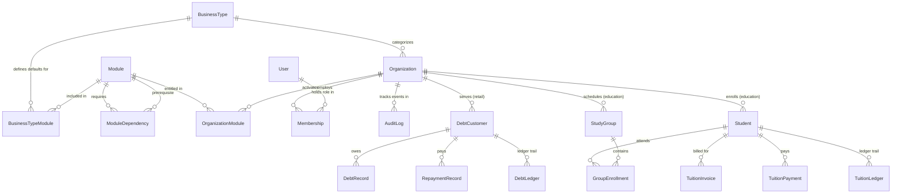

# IDROK AI — Database Schema Specification

**Status:** Proposed Architecture  
**Primary Database:** SQLite3 (Local Dev & First MVP)  
**Production Database:** PostgreSQL 16+ (validated migration target)
**ORM Engine:** Django ORM with Database-Agnostic Models  

---

## 1. Data Modeling Standards

1. **Primary Keys:** Every model uses an immutable UUIDv4 primary key (`models.UUIDField(primary_key=True, default=uuid.uuid4, editable=False)`).
2. **Tenant Scoping:** All tenant-owned records inherit from `OrganizationScopedModel`, which enforces a mandatory, indexed foreign key to `Organization` (`on_delete=models.PROTECT`).
3. **Compound Tenant Indexes:** Every tenant-owned table defines compound database indexes starting with `company_id` (e.g. `index_together = [['organization', 'phone_number']]`).
4. **Monetary Precision:** All monetary balances, debts, prices, and payments strictly use `models.DecimalField(max_digits=12, decimal_places=2)`. Floating point types are prohibited.
5. **Double-Entry Ledgers:** Financial balance adjustments never overwrite ledger history; education postings write balanced immutable journal lines; cached balances are projections recomputed using Decimal. Existing retail balance logs are not proof of double-entry accounting.
6. **Portability:** Dialect-specific extensions (PostgreSQL `ArrayField`, `HStoreField`, native JSONB operators) are excluded in favor of standard ANSI SQL constructs and standard `models.JSONField(default=dict, blank=True)`.

---

## 2. Entity-Relationship Overview

---

## 3. Platform & Tenancy Core Schemas

### 3.1 `BusinessType`
Defines an industry vertical template supported by the platform.

| Field Name | Type | Constraints / Attributes | Description |
| --- | --- | --- | --- |
| `id` | UUID | Primary Key, default=uuid4 | Unique identifier |
| `code` | VARCHAR(64) | Unique, db_index=True | Slug identifier (`retail_store`, `education_center`) |
| `name` | VARCHAR(128) | Not Null | Display name (e.g. "Do'kon / Chakana Savdo") |
| `description` | TEXT | Blank=True | Detailed description of the business vertical |
| `is_active` | BOOLEAN | Default=True, db_index=True | Whether new organizations can choose this type |
| `created_at` | DATETIME | auto_now_add=True | Timestamp UTC |
| `updated_at` | DATETIME | auto_now=True | Timestamp UTC |

### 3.2 `Organization` (Tenant)
Represents an independent business entity (shop, school, clinic).

| Field Name | Type | Constraints / Attributes | Description |
| --- | --- | --- | --- |
| `id` | UUID | Primary Key, default=uuid4 | Unique identifier |
| `name` | VARCHAR(255) | Not Null, db_index=True | Official business name |
| `slug` | VARCHAR(128) | Unique, db_index=True | URL-safe identifier |
| `business_type_id`| FK (BusinessType) | Not Null, on_delete=PROTECT | Industry type template |
| `phone` | VARCHAR(32) | Blank=True | Contact phone number |
| `address` | VARCHAR(512) | Blank=True | Physical address |
| `currency` | VARCHAR(10) | Default='UZS' | Operating currency |
| `status` | VARCHAR(24) | Default='active', db_index=True | Status: `active`, `suspended`, `pending_verification` |
| `created_at` | DATETIME | auto_now_add=True | Timestamp UTC |
| `updated_at` | DATETIME | auto_now=True | Timestamp UTC |

### 3.3 `Module`
System-wide registry of available functional modules.

| Field Name | Type | Constraints / Attributes | Description |
| --- | --- | --- | --- |
| `id` | UUID | Primary Key, default=uuid4 | Unique identifier |
| `code` | VARCHAR(64) | Unique, db_index=True | Immutable slug (`retail_debts`, `edu_tuition`) |
| `name` | VARCHAR(128) | Not Null | Human-readable name |
| `description` | TEXT | Blank=True | Feature overview |
| `category` | VARCHAR(64) | Not Null | Grouping: `retail`, `education`, `core`, `finance` |
| `depends_on_id` | Legacy FK (Module) | Existing implementation only | Migrate edges to ModuleDependency, then retire after compatibility review |
| `is_system` | BOOLEAN | Default=False | Core platform module that cannot be deactivated |
| `is_active` | BOOLEAN | Default=True | Globally active module flag |
| `created_at` | DATETIME | auto_now_add=True | Timestamp UTC |

### 3.4 `BusinessTypeModule`
Mapping between a `BusinessType` and eligible `Module`s.

| Field Name | Type | Constraints / Attributes | Description |
| --- | --- | --- | --- |
| `id` | UUID | Primary Key, default=uuid4 | Unique identifier |
| `business_type_id`| FK (BusinessType) | on_delete=PROTECT | Business vertical |
| `module_id` | FK (Module) | on_delete=PROTECT | Associated module |
| `is_default` | BOOLEAN | Default=True | Automatically enabled on tenant creation |
| `is_mandatory` | BOOLEAN | Default=False | Cannot be disabled for this business type |
| **UniqueConstraint** | `(business_type, module)` | Unique combination |

### 3.5 `OrganizationModule`
Per-tenant module activation and configuration record.

| Field Name | Type | Constraints / Attributes | Description |
| --- | --- | --- | --- |
| `id` | UUID | Primary Key, default=uuid4 | Unique identifier |
| `company_id` | FK (Company) | on_delete=PROTECT | Tenant organization |
| `module_id` | FK (Module) | on_delete=PROTECT | Functional module |
| `is_enabled` | BOOLEAN | Default=True, db_index=True | Runtime activation status |
| `config` | JSONField | Default=dict, Blank=True | Tenant-specific module settings |
| `activated_at` | DATETIME | auto_now_add=True | Timestamp of first activation |
| `deactivated_at` | DATETIME | Nullable | Timestamp of last deactivation |
| `updated_at` | DATETIME | auto_now=True | Timestamp UTC |
| **UniqueConstraint** | `(organization, module)` | Unique combination |

### 3.6 `Membership` (RBAC)
Maps a `User` to an `Organization` with a specific business role.

| Field Name | Type | Constraints / Attributes | Description |
| --- | --- | --- | --- |
| `id` | UUID | Primary Key, default=uuid4 | Unique identifier |
| `company_id` | FK (Company) | on_delete=PROTECT, db_index=True | Tenant organization |
| `user_id` | FK (User) | on_delete=PROTECT, db_index=True | Authenticated user |
| `role` | VARCHAR(32) | db_index=True | Role (`org_owner`, `org_manager`, `cashier`, `teacher`, `accountant`) |
| `is_active` | BOOLEAN | Default=True | Active staff status |
| `created_at` | DATETIME | auto_now_add=True | Joined timestamp |
| **UniqueConstraint** | `(organization, user)` | Unique combination |

### 3.7 `AuditLog`
Immutable system audit log for platform and tenant security.

| Field Name | Type | Constraints / Attributes | Description |
| --- | --- | --- | --- |
| `id` | UUID | Primary Key, default=uuid4 | Unique identifier |
| `company_id` | FK (Company) | Nullable, on_delete=SET_NULL | Tenant scope (Null for Super Admin platform events) |
| `actor_id` | FK (User) | Nullable, on_delete=SET_NULL | User who performed the action |
| `action` | VARCHAR(64) | Not Null, db_index=True | Action code (`MODULE_ENABLED`, `ORG_SUSPENDED`) |
| `target_type` | VARCHAR(64) | Not Null | Target model name |
| `target_id` | UUID | Nullable | Target record ID |
| `details` | JSONField | Default=dict | Serialized event payload and diff |
| `ip_address` | VARCHAR(45) | Blank=True | Client IP address |
| `timestamp` | DATETIME | auto_now_add=True, db_index=True| Event timestamp UTC |

---

## 4. Retail Store Domain Schemas

### 4.1 `DebtCustomer`
Debtor customer profile belonging to an organization.

| Field Name | Type | Constraints / Attributes | Description |
| --- | --- | --- | --- |
| `id` | UUID | Primary Key, default=uuid4 | Unique identifier |
| `company_id` | FK (Company) | on_delete=PROTECT, db_index=True | Tenant owner |
| `full_name` | VARCHAR(255) | Not Null, db_index=True | Customer full name |
| `phone_number` | VARCHAR(32) | Not Null, db_index=True | Contact phone |
| `address` | VARCHAR(512) | Blank=True | Residence or shop address |
| `credit_limit` | DECIMAL(12, 2) | Default=0.00, Check >= 0 | Maximum allowed debt |
| `current_balance`| DECIMAL(12, 2) | Default=0.00, Check >= 0 | Current outstanding unpaid debt |
| `status` | VARCHAR(16) | Default='active' | `active`, `frozen`, `archived` |
| `notes` | TEXT | Blank=True | Operational comments |
| `created_at` | DATETIME | auto_now_add=True | Timestamp UTC |
| `updated_at` | DATETIME | auto_now=True | Timestamp UTC |
| **Index** | `(organization, phone_number)` | Compound index for rapid search |

### 4.2 `DebtRecord`
An issuance of debt ("Nasiya savdo") for purchased goods.

| Field Name | Type | Constraints / Attributes | Description |
| --- | --- | --- | --- |
| `id` | UUID | Primary Key, default=uuid4 | Unique identifier |
| `company_id` | FK (Company) | on_delete=PROTECT, db_index=True | Tenant owner |
| `customer_id` | FK (DebtCustomer) | on_delete=PROTECT, db_index=True | Debtor customer |
| `amount` | DECIMAL(12, 2) | Check > 0 | Principal debt amount |
| `remaining_unpaid`| DECIMAL(12, 2)| Check >= 0 | Unpaid balance of this debt |
| `description` | TEXT | Not Null | Itemized list of goods |
| `due_date` | DATE | Nullable, db_index=True | Promised repayment date |
| `status` | VARCHAR(16) | Default='pending', db_index=True | `pending`, `partially_paid`, `paid`, `overdue` |
| `idempotency_key` | UUID | Unique, Nullable | Client idempotency token |
| `recorded_by_id` | FK (User) | Nullable, on_delete=SET_NULL | Cashier who entered the record |
| `created_at` | DATETIME | auto_now_add=True | Timestamp UTC |

### 4.3 `RepaymentRecord`
A payment received from a customer settling debts.

| Field Name | Type | Constraints / Attributes | Description |
| --- | --- | --- | --- |
| `id` | UUID | Primary Key, default=uuid4 | Unique identifier |
| `company_id` | FK (Company) | on_delete=PROTECT, db_index=True | Tenant owner |
| `customer_id` | FK (DebtCustomer) | on_delete=PROTECT, db_index=True | Debtor customer |
| `debt_id` | FK (DebtRecord) | Nullable, on_delete=SET_NULL | Optional specific debt |
| `amount` | DECIMAL(12, 2) | Check > 0 | Repayment amount |
| `payment_method` | VARCHAR(16) | Default='cash' | `cash`, `card`, `bank_transfer` |
| `notes` | TEXT | Blank=True | Cashier shift notes |
| `idempotency_key` | UUID | Unique, Not Null | Mandatory idempotency token |
| `recorded_by_id` | FK (User) | Nullable, on_delete=SET_NULL | Cashier |
| `created_at` | DATETIME | auto_now_add=True | Timestamp UTC |

### 4.4 `DebtLedger`
Immutable audit ledger tracking every balance mutation.

| Field Name | Type | Constraints / Attributes | Description |
| --- | --- | --- | --- |
| `id` | UUID | Primary Key, default=uuid4 | Unique identifier |
| `company_id` | FK (Company) | on_delete=PROTECT, db_index=True | Tenant owner |
| `customer_id` | FK (DebtCustomer) | on_delete=PROTECT, db_index=True | Customer |
| `transaction_type`| VARCHAR(32) | Not Null | `DEBT_ISSUED`, `REPAYMENT_RECEIVED`, `ADJUSTMENT` |
| `amount` | DECIMAL(12, 2) | Not Null | Transaction magnitude |
| `balance_before` | DECIMAL(12, 2) | Not Null | Balance prior to mutation |
| `balance_after` | DECIMAL(12, 2) | Not Null | Balance following mutation |
| `reference_id` | UUID | Not Null | DebtRecord or RepaymentRecord ID |
| `created_at` | DATETIME | auto_now_add=True | Timestamp UTC |

---

## 5. Shared core extensions and naming reconciliation

All schema tables above are target descriptions, not implemented field guarantees. Persist company_id (existing Company) instead of introducing Organization tables or organization_id columns. Reuse CompanyMember and operations.AuditEvent; “AuditLog” above is conceptual. Existing legacy retail schema and code differences are not migrated in this task. Existing financial tables cannot be deleted or renamed as part of education rollout.

| Model/change | Required fields and invariants |
| --- | --- |
| Company additions | timezone (IANA, default Asia/Tashkent), access_version positive integer default 1; preserve current business_type/status/is_active fields. Operational access requires status=active AND is_active. Business type changes are privileged dependency-aware migrations, not simple tenant edits. |
| ModuleDependency | module FK PROTECT, prerequisite FK PROTECT; unique(module, prerequisite), no self-edge check; cycle detection in service. Multiple transitive prerequisites supported. |
| OrganizationModule | Existing unique(company,module); absent row is disabled. Default new optional grant false. first activated_at, last_enabled_at, deactivated_at distinguish lifecycle. Config has registered schema and no secrets. Module FK PROTECT; mutation through audited service only. |
| CompanyMember | Existing unique(company,user); add edu_owner, edu_assistant_admin, edu_operations_manager and student; teacher already exists. Validate role by business type; never accept platform_super_admin as a tenant-assigned role. Protect last active owner transactionally. |
| AuditEvent extension | Reuse existing actor/company/action/resource/metadata; add request_id and batch_id as needed. Metadata includes reason, before/after, access_version; append-only and redacted. Financial events commit atomically with records. |
| Subscription (proposed) | company FK PROTECT, plan_code, status, starts_at, ends_at, version; one current subscription selected explicitly; dates valid. SubscriptionModuleEntitlement unique(subscription,module); normalized quotas. Absence follows documented manual provisioning, not fabricated paid status. |
| IdempotencyRecord | company, actor, operation, key, request_hash, status, response_reference, expires_at; unique(company,actor,operation,key). Hash mismatch 409; pending 409; guard authorization before replay. Financial business uniqueness outlives 24-hour HTTP response cache. |
| DurableJob / Outbox | company, required modules, actor/system identity, business_key, access_version, status, attempts, error_code, timestamps; unique(company,operation,business_key). paused_module is nonexecuting. Dispatch lease/drain metadata coordinates disablement. |

Audit/company/financial history must not cascade-delete. Archive centers and profiles; use PROTECT on financial relations. User removal may null actor links while preserving actor identifier snapshots. Deletion behavior is chosen per relationship; financial history is protected. Nonfinancial child cleanup is separately authorized and never triggered by a module toggle.

## 6. Education data model

All following records have UUID id, company FK PROTECT, created_at/updated_at UTC where mutable; company comes from authenticated context, never writable JSON. Every FK must belong to the same company and permitted scope, checked in the service. UUID foreign keys alone do not enforce tenant equality. Unique constraints include company. Index by (company, primary filter/date/status) and (company, referenced parent); avoid redundant single-column indexes where unnecessary. Immutable rows have created_at and actor, not editable updated_at. Use portable FK/unique/check constraints and service validation; no PostgreSQL-only assumptions.

| Model / owner module | Fields | Constraints and behavior |
| --- | --- | --- |
| StudentProfile / edu_students | membership nullable OneToOne CompanyMember PROTECT, student_number, full_name, phone, guardian_name/phone optional, admitted_on, status(active/suspended/graduated/archived), restricted_notes | unique(company,student_number); linked membership same company + student role. No second User or authentication fields. Restricted notes excluded from learner/teacher output. No tuition or XP authoritative balance on profile. |
| TeacherProfile / edu_students | membership OneToOne CompanyMember PROTECT, display_name, specialty, status | Membership teacher role and same company; no duplicated credentials. |
| StudyGroup / edu_groups | code, name, course_name, starts_on, ends_on nullable, capacity positive, status | unique(company,code); dates ordered; capacity enforced during enrollment under company write boundary. No room, schedule or monetary fields bundled into this model. |
| TeacherGroupAssignment / edu_groups | teacher FK, group FK, starts_on, ends_on nullable, active | Unique(company,teacher,group,starts_on); nonoverlapping intervals per pair; determines teacher scope. |
| GroupEnrollment / edu_groups | student FK, group FK, starts_on, ends_on nullable, status(active/withdrawn/completed) | Unique(company,student,group,starts_on); prevent overlapping active intervals; preserve withdrawal/completion history. |
| Classroom / edu_classrooms | code, name, capacity positive, location, active | unique(company,code); archived not deleted while referenced. |
| ScheduleRule / edu_scheduling | group FK, teacher FK, classroom nullable FK, weekday 0..6, local_start/end, effective_from/to, timezone, version | Local end after start, date range valid; classroom assignment requires classrooms gate. Service expands timezone-aware occurrences with explicit DST policy: reject ambiguous/nonexistent local time until explicit occurrence offset chosen. |
| LessonSession / edu_scheduling or edu_attendance | group FK, teacher FK, classroom nullable FK, schedule_rule nullable FK, starts_at, ends_at, source(scheduled/ad_hoc), status, version | unique(company,schedule_rule,starts_at) for generated sessions; end > start. source=scheduled requires rule; ad_hoc has no rule. Scheduling creates scheduled sessions, attendance creates ad_hoc sessions. Owner module gate follows source. Conflict checks on room/teacher/group active intervals serialized per company; no exclusion constraints. |
| AttendanceRecord / edu_attendance | session FK, enrollment FK, status(present/absent/late/excused), marked_by FK membership, marked_at, version, note | unique(company,session,enrollment); enrollment.group matches session.group and lesson date lies in enrollment interval. Scheduled session access also needs scheduling. Corrections audited with before/after, version required; not mutable after group archival without owner correction workflow. |
| FeeAgreement / edu_tuition | enrollment FK, monthly_amount Decimal(12,2), currency, effective_from/to (month starts), version | Nonnegative fee; nonoverlapping intervals for same enrollment; snapshot price in each charge. Currency matches company; no cross-currency allocations. Full-month flat fee unless owner records explicit discount; no implicit proration. |
| TuitionCharge (TuitionInvoice conceptual successor) / edu_tuition | enrollment FK, billing_month date(first day), fee_agreement FK, base_amount, discount_amount, net_amount Decimal(12,2), due_on, currency, posted_at | unique(company,enrollment,billing_month); discount between 0 and base; net=base-discount. Posted immutable; paid/remaining/status computed from ledger allocations, not client editable. An explicit zero-net scholarship charge is valid. |
| TuitionPayment / edu_tuition | student FK, amount Decimal(12,2)>0, currency, method(cash/card/bank_transfer), receipt_number, external_reference nullable, recorded_by membership, received_at, posted_at | unique(company,receipt_number); immutable, no PUT/PATCH/DELETE/admin edits. Receipt entry records money received, not external gateway capture. Duplicate external reference within method/company rejected when provided. |
| PaymentAllocation / edu_tuition | payment FK, charge FK, amount Decimal(12,2)>0, posted_at | unique(company,payment,charge); student/currency match; total allocations = payment amount, each charge not overpaid. No unapplied credit in initial scope. Service validates under serialized transaction. |
| PaymentReversal / edu_tuition | payment OneToOne FK, reason, amount, actor, journal FK, posted_at | Full reversal only; amount original amount; exactly one reversal per payment. Original remains immutable; inverse allocations restore outstanding charges. Owner only; no real-world refund implied. |
| TuitionJournal / edu_tuition | event_type, source_type, source_id, currency, reversal_of nullable, posted_at, actor | unique(company,source_type,source_id,event_type); immutable. Corrections append a ChargeAdjustment and corresponding inverse/additional journal, never overwrite a posted invoice. |
| TuitionJournalLine / edu_tuition | journal FK, account_code, student FK, charge/payment nullable FKs, debit Decimal(12,2), credit Decimal(12,2) | Exactly one positive side per line; balanced sum(debit)=sum(credit) per journal checked using Decimal before posting. Charge: Dr receivable/Cr tuition revenue; receipt: Dr cash-or-bank/Cr receivable; reversal inverse. Not a complete statutory accounting/tax product. |
| HomeworkAssignment / edu_homework | group FK, author membership, title, instructions, due_at, max_score positive Decimal(8,2), version, status(draft/published/closed), published_at | Publication snapshot/version immutable; corrections create new version; assigned teachers only. |
| HomeworkSubmission / edu_homework | assignment FK/version, enrollment FK, attempt_number positive, answer_text, private asset FK nullable, submitted_at, score nullable Decimal(8,2), feedback, graded_by nullable | unique(company,assignment,enrollment,attempt_number); student cannot change grades. Published grade revisions audited; service enforces score <= assignment max. Parent assignment/enrollment groups match. |
| EducationTest / edu_exams | group FK, title, opens_at/closes_at, duration_seconds, attempt_limit, status, published_version, results_released_at | Positive duration/attempt limit, closing after opening; immutable published version. |
| TestQuestion / edu_exams | test FK, version, position, kind(single_choice/text), prompt, points Decimal(8,2)>0 | unique(company,test,version,position). Answer key in separate TestAnswerKey; author-only serializer. |
| TestOption / TestAnswerKey / edu_exams | option: question FK, position, text; answer key: question OneToOne, correct_option FK nullable, grading rubric | Same test/question validation; single-choice exactly one correct option; no key in learner responses/exports. |
| TestAttempt / edu_exams | test FK/version, enrollment FK, attempt_number, started_at, expires_at, submitted_at nullable, status, version | unique(company,test,enrollment,attempt_number); limit and active attempt enforced via company write boundary; server time determines expiry. Resume same active attempt; answers after deadline rejected. |
| AttemptAnswer / edu_exams | attempt FK, question FK, selected_option nullable FK, answer_text | unique(company,attempt,question); test version and option ownership validated; frozen on submission. |
| TestResult / edu_exams | attempt OneToOne, score Decimal(8,2), max_score, graded_by nullable, graded_at, released_at nullable, version | Score in range; release explicitly controls student visibility. Grade revisions append audited version history; student never supplies scores. |
| VideoLesson / edu_lms | group FK, author, title, private_asset FK, duration_seconds positive, status, published_at | Scoped private asset or approved protected source; no public bearer URLs that survive disablement. |
| VideoProgress / edu_lms | video FK, enrollment FK, position_seconds, completed_at nullable, version | unique(company,video,enrollment); 0 <= position <= duration; server bounds completion input. Progress not proof of attendance or exam completion. |
| GamificationTransaction / edu_gamification | student FK, asset(xp/coins), signed integer delta nonzero, reason, source_module, source_event_id, rule_version, reversal_of nullable, actor | unique(company,student,asset,source_event_id,rule_version); one compensating reversal per original. Append-only; no money conversion. Serialized nonnegative coin balance; XP reversal allowed only linked/capped to original. |
| Reward / edu_gamification | code, title, coin_cost positive integer, stock nonnegative integer, active | unique(company,code); mutable catalog version; no tuition discount/cash exchange in scope. |
| RewardRedemption / edu_gamification | student FK, reward FK, cost snapshot, transaction FK, status, fulfilled_by nullable, fulfilled_at nullable | Atomic stock decrement and coin debit + immutable redemption event; student cannot fulfill own reward. Cancel appends reversal/restocks once. |
| EducationAsset / parent module | company, owning_module, owner_resource_type/id, opaque_storage_key, content_type, size, checksum, status | Private storage key is not a public URL; content validated, access checks parent object and module each request. Module disable preserves binary data. |
| EducationReportJob / edu_reports | company, requested_by, dataset, source_modules, access_version, scope, status, private_asset nullable, timestamps | Revalidate source modules/role at generation, poll and download; no data snapshots visible after revocation. |

## 7. Financial transaction and concurrency rules

All payment/allocation/journal/audit/idempotency writes commit in one atomic transaction, after the first-write Company access_version guard and current authorization checks. Read fresh charges/allocations; use Decimal arithmetic, check positive amount, currency, exact allocation sum and remaining balance, then persist. Never trust client totals, paid flags or balances. No browser/server floats and no SQLite SUM/F money arithmetic as accounting authority. SQLite numeric affinity is not fixed decimal storage; bounded values/quantization and round-trip checks are required before monetary release.

Idempotency matches company+actor+operation+key, with a separate body hash; changed body is 409, matching complete retries return stored authorized response, pending is 409. Receipt/business source uniqueness persists after cache expiry. Unique monthly charge keys prevent duplicate recurring invoices across jobs, retries and re-enable. No charge/backfill occurs automatically for periods while tuition was disabled.

Financial business rules are not made safe by transaction.atomic alone. SQLite serializes writers, can fail on lock upgrades and has no row locking; acquire company write boundary first, retry whole rolled-back transaction for busy/conflict with bounded backoff, then 503 Retry-After. Serialize schedule/capacity/attempt/redemption invariants similarly. PostgreSQL later adds row locks/RLS without removing service checks. No concurrency guarantee is claimed until those workflows have adversarial tests.

Private upload lifecycle: authorize purpose and group/assignment parent, store staged creator-only asset, then bind on video/assignment/submission creation after company/group/actor checks. Learners cannot stream staged/unpublished videos. Homework submission upload uses submissions.submit, not teacher homework.manage. No unsigned permanent storage URL is exposed. Ownership FKs on existing education records cannot be reparented through PATCH; schedule teacher/classroom changes affect future occurrences through conflict-checked services.

ChargeAdjustment / edu_tuition: immutable company/charge FK PROTECT, direction(debit/credit), positive DecimalField(12,2) amount, currency, reason, actor, journal FK and posted_at. Owner-only tuition.adjust posts a balanced receivable/revenue adjustment and audit atomically. Net obligation is original net plus debit adjustments minus credit adjustments; credit cannot reduce below already allocated payments (reverse receipts first when necessary). The original monthly charge uniqueness remains unchanged; adjustments do not create duplicate monthly charges.
