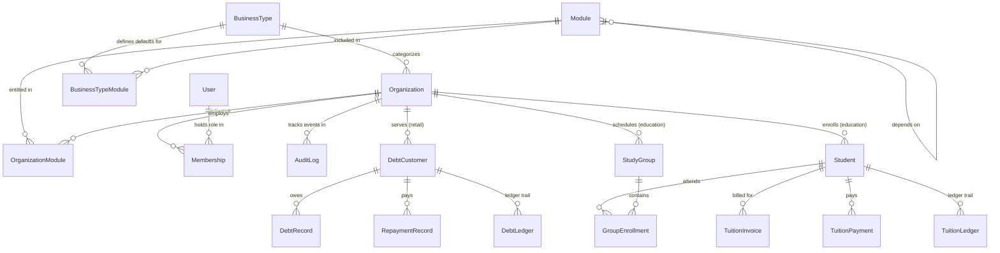

# IDROK AI — Database Schema Specification

**Status:** Proposed Architecture  
**Primary Database:** SQLite3 (Local Dev & First MVP)  
**Production Database:** PostgreSQL 16+ (Seamless migration target)  
**ORM Engine:** Django ORM with Database-Agnostic Models  

---

## 1. Data Modeling Standards

1. **Primary Keys:** Every model uses an immutable UUIDv4 primary key (`models.UUIDField(primary_key=True, default=uuid.uuid4, editable=False)`).
2. **Tenant Scoping:** All tenant-owned records inherit from `OrganizationScopedModel`, which enforces a mandatory, indexed foreign key to `Organization` (`on_delete=models.CASCADE`).
3. **Compound Tenant Indexes:** Every tenant-owned table defines compound database indexes starting with `organization_id` (e.g. `index_together = [['organization', 'phone_number']]`).
4. **Monetary Precision:** All monetary balances, debts, prices, and payments strictly use `models.DecimalField(max_digits=12, decimal_places=2)`. Floating point types are prohibited.
5. **Double-Entry Ledgers:** Financial balance adjustments never overwrite ledger history; mutations write an immutable ledger record before updating the cached balance via atomic `F()` expressions.
6. **Portability:** Dialect-specific extensions (PostgreSQL `ArrayField`, `HStoreField`, native JSONB operators) are excluded in favor of standard ANSI SQL constructs and standard `models.JSONField(default=dict, blank=True)`.

---

## 2. Entity-Relationship Overview

---

## 3. Platform & Tenancy Core Schemas

### 3.1 `BusinessType`
Defines an industry vertical template supported by the platform.

| Field Name | Type | Constraints / Attributes | Description |
| --- | --- | --- | --- |
| `id` | UUID | Primary Key, default=uuid4 | Unique identifier |
| `code` | VARCHAR(64) | Unique, db_index=True | Slug identifier (`retail_store`, `education_center`) |
| `name` | VARCHAR(128) | Not Null | Display name (e.g. "Do'kon / Chakana Savdo") |
| `description` | TEXT | Blank=True | Detailed description of the business vertical |
| `is_active` | BOOLEAN | Default=True, db_index=True | Whether new organizations can choose this type |
| `created_at` | DATETIME | auto_now_add=True | Timestamp UTC |
| `updated_at` | DATETIME | auto_now=True | Timestamp UTC |

### 3.2 `Organization` (Tenant)
Represents an independent business entity (shop, school, clinic).

| Field Name | Type | Constraints / Attributes | Description |
| --- | --- | --- | --- |
| `id` | UUID | Primary Key, default=uuid4 | Unique identifier |
| `name` | VARCHAR(255) | Not Null, db_index=True | Official business name |
| `slug` | VARCHAR(128) | Unique, db_index=True | URL-safe identifier |
| `business_type_id`| FK (BusinessType) | Not Null, on_delete=PROTECT | Industry type template |
| `phone` | VARCHAR(32) | Blank=True | Contact phone number |
| `address` | VARCHAR(512) | Blank=True | Physical address |
| `currency` | VARCHAR(10) | Default='UZS' | Operating currency |
| `status` | VARCHAR(24) | Default='active', db_index=True | Status: `active`, `suspended`, `pending_verification` |
| `created_at` | DATETIME | auto_now_add=True | Timestamp UTC |
| `updated_at` | DATETIME | auto_now=True | Timestamp UTC |

### 3.3 `Module`
System-wide registry of available functional modules.

| Field Name | Type | Constraints / Attributes | Description |
| --- | --- | --- | --- |
| `id` | UUID | Primary Key, default=uuid4 | Unique identifier |
| `code` | VARCHAR(64) | Unique, db_index=True | Immutable slug (`retail_debts`, `edu_tuition`) |
| `name` | VARCHAR(128) | Not Null | Human-readable name |
| `description` | TEXT | Blank=True | Feature overview |
| `category` | VARCHAR(64) | Not Null | Grouping: `retail`, `education`, `core`, `finance` |
| `depends_on_id` | FK (Module) | Nullable, on_delete=SET_NULL | Required parent module |
| `is_system` | BOOLEAN | Default=False | Core platform module that cannot be deactivated |
| `is_active` | BOOLEAN | Default=True | Globally active module flag |
| `created_at` | DATETIME | auto_now_add=True | Timestamp UTC |

### 3.4 `BusinessTypeModule`
Mapping between a `BusinessType` and eligible `Module`s.

| Field Name | Type | Constraints / Attributes | Description |
| --- | --- | --- | --- |
| `id` | UUID | Primary Key, default=uuid4 | Unique identifier |
| `business_type_id`| FK (BusinessType) | on_delete=CASCADE | Business vertical |
| `module_id` | FK (Module) | on_delete=CASCADE | Associated module |
| `is_default` | BOOLEAN | Default=True | Automatically enabled on tenant creation |
| `is_mandatory` | BOOLEAN | Default=False | Cannot be disabled for this business type |
| **UniqueConstraint** | `(business_type, module)` | Unique combination |

### 3.5 `OrganizationModule`
Per-tenant module activation and configuration record.

| Field Name | Type | Constraints / Attributes | Description |
| --- | --- | --- | --- |
| `id` | UUID | Primary Key, default=uuid4 | Unique identifier |
| `organization_id` | FK (Organization) | on_delete=CASCADE | Tenant organization |
| `module_id` | FK (Module) | on_delete=CASCADE | Functional module |
| `is_enabled` | BOOLEAN | Default=True, db_index=True | Runtime activation status |
| `config` | JSONField | Default=dict, Blank=True | Tenant-specific module settings |
| `activated_at` | DATETIME | auto_now_add=True | Timestamp of first activation |
| `deactivated_at` | DATETIME | Nullable | Timestamp of last deactivation |
| `updated_at` | DATETIME | auto_now=True | Timestamp UTC |
| **UniqueConstraint** | `(organization, module)` | Unique combination |

### 3.6 `Membership` (RBAC)
Maps a `User` to an `Organization` with a specific business role.

| Field Name | Type | Constraints / Attributes | Description |
| --- | --- | --- | --- |
| `id` | UUID | Primary Key, default=uuid4 | Unique identifier |
| `organization_id` | FK (Organization) | on_delete=CASCADE, db_index=True | Tenant organization |
| `user_id` | FK (User) | on_delete=CASCADE, db_index=True | Authenticated user |
| `role` | VARCHAR(32) | db_index=True | Role (`org_owner`, `org_manager`, `cashier`, `teacher`, `accountant`) |
| `is_active` | BOOLEAN | Default=True | Active staff status |
| `created_at` | DATETIME | auto_now_add=True | Joined timestamp |
| **UniqueConstraint** | `(organization, user)` | Unique combination |

### 3.7 `AuditLog`
Immutable system audit log for platform and tenant security.

| Field Name | Type | Constraints / Attributes | Description |
| --- | --- | --- | --- |
| `id` | UUID | Primary Key, default=uuid4 | Unique identifier |
| `organization_id` | FK (Organization) | Nullable, on_delete=SET_NULL | Tenant scope (Null for Super Admin platform events) |
| `actor_id` | FK (User) | Nullable, on_delete=SET_NULL | User who performed the action |
| `action` | VARCHAR(64) | Not Null, db_index=True | Action code (`MODULE_ENABLED`, `ORG_SUSPENDED`) |
| `target_type` | VARCHAR(64) | Not Null | Target model name |
| `target_id` | UUID | Nullable | Target record ID |
| `details` | JSONField | Default=dict | Serialized event payload and diff |
| `ip_address` | VARCHAR(45) | Blank=True | Client IP address |
| `timestamp` | DATETIME | auto_now_add=True, db_index=True| Event timestamp UTC |

---

## 4. Retail Store Domain Schemas

### 4.1 `DebtCustomer`
Debtor customer profile belonging to an organization.

| Field Name | Type | Constraints / Attributes | Description |
| --- | --- | --- | --- |
| `id` | UUID | Primary Key, default=uuid4 | Unique identifier |
| `organization_id` | FK (Organization) | on_delete=CASCADE, db_index=True | Tenant owner |
| `full_name` | VARCHAR(255) | Not Null, db_index=True | Customer full name |
| `phone_number` | VARCHAR(32) | Not Null, db_index=True | Contact phone |
| `address` | VARCHAR(512) | Blank=True | Residence or shop address |
| `credit_limit` | DECIMAL(12, 2) | Default=0.00, Check >= 0 | Maximum allowed debt |
| `current_balance`| DECIMAL(12, 2) | Default=0.00, Check >= 0 | Current outstanding unpaid debt |
| `status` | VARCHAR(16) | Default='active' | `active`, `frozen`, `archived` |
| `notes` | TEXT | Blank=True | Operational comments |
| `created_at` | DATETIME | auto_now_add=True | Timestamp UTC |
| `updated_at` | DATETIME | auto_now=True | Timestamp UTC |
| **Index** | `(organization, phone_number)` | Compound index for rapid search |

### 4.2 `DebtRecord`
An issuance of debt ("Nasiya savdo") for purchased goods.

| Field Name | Type | Constraints / Attributes | Description |
| --- | --- | --- | --- |
| `id` | UUID | Primary Key, default=uuid4 | Unique identifier |
| `organization_id` | FK (Organization) | on_delete=CASCADE, db_index=True | Tenant owner |
| `customer_id` | FK (DebtCustomer) | on_delete=CASCADE, db_index=True | Debtor customer |
| `amount` | DECIMAL(12, 2) | Check > 0 | Principal debt amount |
| `remaining_unpaid`| DECIMAL(12, 2)| Check >= 0 | Unpaid balance of this debt |
| `description` | TEXT | Not Null | Itemized list of goods |
| `due_date` | DATE | Nullable, db_index=True | Promised repayment date |
| `status` | VARCHAR(16) | Default='pending', db_index=True | `pending`, `partially_paid`, `paid`, `overdue` |
| `idempotency_key` | UUID | Unique, Nullable | Client idempotency token |
| `recorded_by_id` | FK (User) | Nullable, on_delete=SET_NULL | Cashier who entered the record |
| `created_at` | DATETIME | auto_now_add=True | Timestamp UTC |

### 4.3 `RepaymentRecord`
A payment received from a customer settling debts.

| Field Name | Type | Constraints / Attributes | Description |
| --- | --- | --- | --- |
| `id` | UUID | Primary Key, default=uuid4 | Unique identifier |
| `organization_id` | FK (Organization) | on_delete=CASCADE, db_index=True | Tenant owner |
| `customer_id` | FK (DebtCustomer) | on_delete=CASCADE, db_index=True | Debtor customer |
| `debt_id` | FK (DebtRecord) | Nullable, on_delete=SET_NULL | Optional specific debt |
| `amount` | DECIMAL(12, 2) | Check > 0 | Repayment amount |
| `payment_method` | VARCHAR(16) | Default='cash' | `cash`, `card`, `bank_transfer` |
| `notes` | TEXT | Blank=True | Cashier shift notes |
| `idempotency_key` | UUID | Unique, Not Null | Mandatory idempotency token |
| `recorded_by_id` | FK (User) | Nullable, on_delete=SET_NULL | Cashier |
| `created_at` | DATETIME | auto_now_add=True | Timestamp UTC |

### 4.4 `DebtLedger`
Immutable audit ledger tracking every balance mutation.

| Field Name | Type | Constraints / Attributes | Description |
| --- | --- | --- | --- |
| `id` | UUID | Primary Key, default=uuid4 | Unique identifier |
| `organization_id` | FK (Organization) | on_delete=CASCADE, db_index=True | Tenant owner |
| `customer_id` | FK (DebtCustomer) | on_delete=CASCADE, db_index=True | Customer |
| `transaction_type`| VARCHAR(32) | Not Null | `DEBT_ISSUED`, `REPAYMENT_RECEIVED`, `ADJUSTMENT` |
| `amount` | DECIMAL(12, 2) | Not Null | Transaction magnitude |
| `balance_before` | DECIMAL(12, 2) | Not Null | Balance prior to mutation |
| `balance_after` | DECIMAL(12, 2) | Not Null | Balance following mutation |
| `reference_id` | UUID | Not Null | DebtRecord or RepaymentRecord ID |
| `created_at` | DATETIME | auto_now_add=True | Timestamp UTC |

---

## 5. Education Center Domain Schemas

### 5.1 `Student`
Enrolled student profile in an education center tenant.

| Field Name | Type | Constraints / Attributes | Description |
| --- | --- | --- | --- |
| `id` | UUID | Primary Key, default=uuid4 | Unique identifier |
| `organization_id` | FK (Organization) | on_delete=CASCADE, db_index=True | Tenant owner |
| `full_name` | VARCHAR(255) | Not Null, db_index=True | Student full name |
| `phone_number` | VARCHAR(32) | Blank=True | Student contact phone |
| `parent_name` | VARCHAR(255) | Blank=True | Parent / Guardian full name |
| `parent_phone` | VARCHAR(32) | Not Null, db_index=True | Primary billing contact phone |
| `enrollment_date` | DATE | Not Null | Date admitted to the academy |
| `current_tuition_debt`| DECIMAL(12, 2)| Default=0.00, Check >= 0 | Total outstanding unpaid tuition |
| `status` | VARCHAR(16) | Default='active' | `active`, `suspended`, `graduated` |
| `created_at` | DATETIME | auto_now_add=True | Timestamp UTC |

### 5.2 `StudyGroup`
Course cohort or classroom group.

| Field Name | Type | Constraints / Attributes | Description |
| --- | --- | --- | --- |
| `id` | UUID | Primary Key, default=uuid4 | Unique identifier |
| `organization_id` | FK (Organization) | on_delete=CASCADE, db_index=True | Tenant owner |
| `name` | VARCHAR(128) | Not Null | Group code (e.g. "IELTS-204", "Frontend-B") |
| `course_name` | VARCHAR(255) | Not Null | Subject or course curriculum |
| `instructor_id` | FK (User) | Nullable, on_delete=SET_NULL | Assigned teacher |
| `schedule_days` | VARCHAR(64) | Blank=True | Days of week (e.g. "Mon-Wed-Fri") |
| `room` | VARCHAR(64) | Blank=True | Room / Classroom number |
| `monthly_fee` | DECIMAL(12, 2) | Not Null, Check > 0 | Standard monthly tuition fee |
| `status` | VARCHAR(16) | Default='active' | `active`, `completed`, `archived` |
| `created_at` | DATETIME | auto_now_add=True | Timestamp UTC |

### 5.3 `TuitionInvoice`
Monthly tuition fee billed to a student for group enrollment.

| Field Name | Type | Constraints / Attributes | Description |
| --- | --- | --- | --- |
| `id` | UUID | Primary Key, default=uuid4 | Unique identifier |
| `organization_id` | FK (Organization) | on_delete=CASCADE, db_index=True | Tenant owner |
| `student_id` | FK (Student) | on_delete=CASCADE, db_index=True | Billed student |
| `group_id` | FK (StudyGroup) | on_delete=CASCADE | Study cohort |
| `invoice_month` | DATE | Not Null | Billing period (e.g. 2026-11-01) |
| `amount_due` | DECIMAL(12, 2) | Not Null, Check > 0 | Net invoice total |
| `amount_paid` | DECIMAL(12, 2) | Default=0.00, Check >= 0 | Paid amount |
| `discount_amount` | DECIMAL(12, 2) | Default=0.00 | Scholarship or discount |
| `due_date` | DATE | Not Null | Payment deadline |
| `status` | VARCHAR(16) | Default='unpaid' | `unpaid`, `partially_paid`, `paid`, `overdue` |
| `created_at` | DATETIME | auto_now_add=True | Timestamp UTC |

### 5.4 `TuitionPayment`
Tuition fee payment received from student/parent.

| Field Name | Type | Constraints / Attributes | Description |
| --- | --- | --- | --- |
| `id` | UUID | Primary Key, default=uuid4 | Unique identifier |
| `organization_id` | FK (Organization) | on_delete=CASCADE, db_index=True | Tenant owner |
| `student_id` | FK (Student) | on_delete=CASCADE, db_index=True | Student |
| `invoice_id` | FK (TuitionInvoice)| Nullable, on_delete=SET_NULL | Targeted invoice |
| `amount` | DECIMAL(12, 2) | Not Null, Check > 0 | Payment amount |
| `payment_method` | VARCHAR(16) | Default='cash' | `cash`, `card`, `bank_transfer` |
| `idempotency_key` | UUID | Unique, Not Null | Idempotency token |
| `recorded_by_id` | FK (User) | Nullable, on_delete=SET_NULL | Accountant / Registrar |
| `created_at` | DATETIME | auto_now_add=True | Timestamp UTC |
