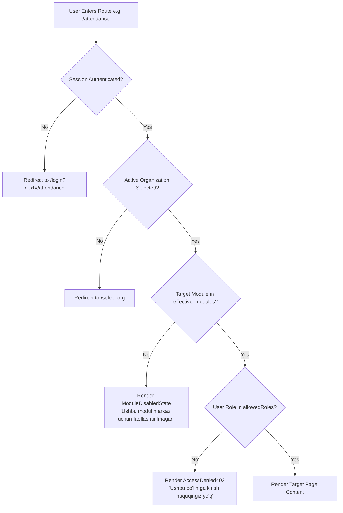

# IDROK AI — Education Center & LMS Frontend Architecture Plan

**Document:** Frontend Architecture & Navigation Specification  
**Location:** `frontend/education/`  
**Status:** Proposed Architecture — Awaiting User Approval Before Implementation  
**Technology:** Next.js (App Router), TypeScript, Tailwind CSS, Dark/Light Themes, REST API Integration  

---

## 1. Executive Summary & Core Principles

The **IDROK AI Education Frontend** is a dedicated, separate Next.js web application designed for private schools, learning centers, language academies, and training institutes. It operates as an API consumer strictly communicating with the unified Django REST Framework backend.

### Non-Negotiable Architectural Rules:
1. **Isolated Frontend Scope:** Lives entirely inside `frontend/education/`. Shares zero template code with Django Admin or Retail Frontend.
2. **Dynamic Capability Resolution:** Never hardcodes tenant features or organization IDs. The enabled modules and effective role permissions are fetched dynamically from `/api/v1/companies/{company_id}/capabilities`.
3. **Defense-in-Depth Protection:** Frontend route guards (`ModuleGuard`, `RoleGuard`) provide responsive UX (preventing layout shift, hiding menu links, displaying explanatory 403 / disabled screens), but backend DRF permissions remain the authoritative security boundary.
4. **Uzbek-First Localization:** Built natively with Uzbek UI terminology, formatted currencies (UZS), and local timezone handling (`Asia/Tashkent`).
5. **No Undocumented APIs:** Strictly adheres to `docs/api-contract.yaml` and `docs/module-system.md`.

---

## 2. Directory & Component Architecture (`frontend/education/`)

```
frontend/education/
├── package.json
├── tsconfig.json
├── tailwind.config.ts
├── postcss.config.js
├── next.config.mjs
├── public/
│   ├── icons/
│   └── images/
└── src/
    ├── app/
    │   ├── layout.tsx                      # Root layout (Theme, Fonts, QueryClient, Toast)
    │   ├── not-found.tsx                   # Global 404 Page
    │   ├── (auth)/
    │   │   ├── login/
    │   │   │   └── page.tsx                # Email/Password session login
    │   │   └── select-org/
    │   │       └── page.tsx                # Organization switcher (membership selection)
    │   ├── (dashboard)/
    │   │   ├── layout.tsx                  # Authenticated Dashboard Shell (Sidebar, Header, Org Context)
    │   │   ├── page.tsx                    # Adaptive Role-based Dashboard Overview
    │   │   │
    │   │   │   # Foundation Modules (Mandatory for Education)
    │   │   ├── students/                   # Module: edu_students
    │   │   │   ├── page.tsx                # Student directory table, search, filters
    │   │   │   └── [id]/page.tsx           # Student profile, enrollments, history
    │   │   ├── groups/                     # Module: edu_groups
    │   │   │   ├── page.tsx                # Groups list, teacher assignments, rooms
    │   │   │   └── [id]/page.tsx           # Group detail, student roster, syllabus
    │   │   │
    │   │   │   # Academic & Operations Modules (Optional)
    │   │   ├── attendance/                 # Module: edu_attendance
    │   │   │   └── page.tsx                # Daily attendance ledger, session grid, marking
    │   │   ├── classrooms/                 # Module: edu_classrooms
    │   │   │   └── page.tsx                # Classroom directory, capacities, equipment
    │   │   ├── timetable/                  # Module: edu_scheduling
    │   │   │   └── page.tsx                # Weekly timetable calendar, teacher/room filters
    │   │   │
    │   │   │   # Financial Modules (Optional)
    │   │   ├── tuition/                    # Module: edu_tuition
    │   │   │   ├── page.tsx                # Invoices, fee agreements, payment transactions
    │   │   │   └── overdue/page.tsx        # Module: edu_debts + edu_tuition (overdue fee tracker)
    │   │   │
    │   │   │   # LMS & Interactive Learning Modules (Optional)
    │   │   ├── homework/                   # Module: edu_homework
    │   │   │   ├── page.tsx                # Homework list, assignments
    │   │   │   └── [id]/page.tsx           # Submissions review, grading interface
    │   │   ├── tests/                      # Module: edu_exams
    │   │   │   ├── page.tsx                # Tests catalog, test taker interface
    │   │   │   └── [id]/results/page.tsx   # Graded attempt results
    │   │   ├── videos/                     # Module: edu_lms
    │   │   │   └── page.tsx                # Video lessons library, progress tracking
    │   │   ├── gamification/               # Module: edu_gamification
    │   │   │   └── page.tsx                # XP points, student leaderboard, reward redemption
    │   │   │
    │   │   │   # Analytics & Settings
    │   │   ├── reports/                    # Module: edu_reports (Source-gated analytics)
    │   │   │   └── page.tsx
    │   │   ├── settings/
    │   │   │   └── page.tsx                # Profile, password, notifications, tenant details
    │   │   ├── 403/
    │   │   │   └── page.tsx                # Role Access Forbidden State
    │   │   └── module-disabled/
    │   │       └── page.tsx                # Module Inactive State for Tenant
    │   └── globals.css
    │
    ├── components/
    │   ├── ui/                             # Reusable Design System Components
    │   │   ├── Button.tsx
    │   │   ├── Input.tsx
    │   │   ├── Select.tsx
    │   │   ├── Modal.tsx
    │   │   ├── Table.tsx
    │   │   ├── Badge.tsx
    │   │   ├── Card.tsx
    │   │   ├── Tabs.tsx
    │   │   ├── Dropdown.tsx
    │   │   └── Toast.tsx
    │   ├── layout/                         # Structural Layout Elements
    │   │   ├── Sidebar.tsx                 # Dynamic sidebar rendering active modules
    │   │   ├── Header.tsx                  # Top navbar, search, notifications, theme toggle
    │   │   ├── OrgSwitcher.tsx             # Dropdown to switch active center
    │   │   ├── UserMenu.tsx                # Avatar, role badge, logout
    │   │   └── MobileNav.tsx               # Responsive slide-over drawer
    │   ├── guards/                         # Security & Entitlement Wrappers
    │   │   ├── RouteGuard.tsx              # Verifies active session & membership
    │   │   ├── ModuleGuard.tsx             # Validates organization module activation
    │   │   └── RoleGuard.tsx               # Validates user role permission
    │   ├── feedback/                       # Standardized UX States
    │   │   ├── LoadingSkeleton.tsx         # Content placeholder skeleton
    │   │   ├── EmptyState.tsx              # Clean empty state with action CTA
    │   │   ├── ErrorState.tsx              # Network/server error retry card
    │   │   └── ModuleDisabledState.tsx     # Informational disabled module notice
    │   └── charts/                         # Visual Analytical Widgets
    │       ├── AttendanceTrendChart.tsx
    │       ├── TuitionCollectionChart.tsx
    │       └── GradeDistributionChart.tsx
    │
    ├── context/
    │   ├── AuthContext.tsx                 # User session, login, logout, me
    │   ├── OrgContext.tsx                  # Active organization, capabilities, effective modules
    │   └── ThemeContext.tsx                # Dark / Light theme persistence
    │
    ├── hooks/
    │   ├── useCapabilities.ts              # Loads & caches /capabilities
    │   ├── useModuleAccess.ts              # Checks hasModule(code)
    │   ├── useRoleAccess.ts                # Checks hasRole(role) or can(action)
    │   └── useDebounce.ts                  # Input debouncing for search
    │
    ├── lib/
    │   ├── api-client.ts                   # Fetch wrapper with CSRF injection & error interception
    │   ├── nav-registry.ts                 # Declarative route-to-module navigation catalog
    │   └── formatters.ts                   # Format UZS, dates, phones in Uzbek locale
    │
    └── types/
        ├── auth.ts                         # User, Membership, Role definitions
        ├── company.ts                      # Company profile, business type
        ├── capabilities.ts                 # Capabilities API payload
        ├── navigation.ts                   # NavItem, NavSection types
        └── education.ts                    # Student, Group, Attendance, Tuition domain types
```

---

## 3. Dynamic Module & Navigation Catalog (`lib/nav-registry.ts`)

Navigation items are **never hardcoded**. Each route declares its module dependency and allowed roles. The sidebar filters routes in real time based on:
1. `capabilities.effective_modules.includes(item.requiredModule)`
2. `item.allowedRoles.includes(user.role)`

| Route Path | Navigation Title (Uzbek) | Module Dependency | Allowed Roles | Description |
| --- | --- | --- | --- | --- |
| `/` | Boshqaruv Paneli | *(None — Core)* | All Roles | Role-customized dashboard overview |
| `/students` | O'quvchilar Bazasi | `edu_students` | Owner, Assistant Admin, Operations Manager, Teacher (Read) | Student directory, admissions, contact cards |
| `/groups` | Guruhlar & Kurslar | `edu_groups` | Owner, Assistant Admin, Operations Manager, Teacher, Student (Read) | Course cohorts, room allocations, enrolled students |
| `/attendance` | Davomat Jurnali | `edu_attendance` | Owner, Assistant Admin, Operations Manager, Teacher (Mark), Student (Read) | Daily roll call, absence tracking, percentage metrics |
| `/classrooms` | Xonalar Fondi | `edu_classrooms` | Owner, Assistant Admin, Operations Manager, Teacher (Read) | Rooms, seating capacity, equipment status |
| `/timetable` | Dars Jadvali | `edu_scheduling` | Owner, Assistant Admin, Operations Manager, Teacher, Student | Weekly timetable, room and teacher conflicts |
| `/tuition` | Oylik To'lovlar | `edu_tuition` | Owner, Assistant Admin, Operations Manager, Student (Own) | Invoices, fee receipts, payment methods |
| `/tuition/overdue` | Qarzdorlik Nazorati | `edu_debts` (`edu_tuition`) | Owner, Assistant Admin, Operations Manager | Overdue tuition debts, student balance warnings |
| `/homework` | Uyga Vazifalar | `edu_homework` | Owner, Assistant Admin, Teacher, Student | Task creation, file submissions, teacher grading |
| `/tests` | Testlar & Imtihonlar | `edu_exams` | Owner, Assistant Admin, Teacher, Student | Online quizzes, midterm exams, automated score computation |
| `/videos` | Video Darslar (LMS) | `edu_lms` | Owner, Assistant Admin, Teacher, Student | Video syllabus, streaming lessons, progress tracking |
| `/gamification` | Reyting & Yutuqlar | `edu_gamification` | All Roles | XP points, badges, center leaderboard, gift shop |
| `/reports` | Tahlil & Hisobotlar | `edu_reports` | Owner, Assistant Admin, Operations Manager | Academic performance, tuition intake, attendance trends |
| `/settings` | Tizim Sozlamalari | *(None — Core)* | All Roles | Personal settings, organization profile |

---

## 4. Role Permissions Matrix (5 User Roles)

| Functional Area | Owner (`org_owner`) | Assistant Admin (`assistant_admin`) | Operations Manager (`operations_manager`) | Teacher (`teacher`) | Student (`student`) |
| --- | :---: | :---: | :---: | :---: | :---: |
| **Organization Switcher** | Yes | Yes | Yes | Yes | Yes |
| **Manage Staff & Roles** | **Full** | View only | No | No | No |
| **Admit New Students** | **Full** | **Full** | **Full** | No | No |
| **Create Groups & Assign Teachers** | **Full** | **Full** | **Full** | View assigned | View enrolled |
| **Manage Classrooms & Schedule** | **Full** | **Full** | **Full** | View assigned | View assigned |
| **Mark Daily Attendance** | **Full** | **Full** | **Full** | **Assigned groups** | View personal |
| **Issue Tuition Invoices & Receive Cash**| **Full** | **Full** | **Full** | No | View personal |
| **Reverse / Refund Tuition Payment** | **Owner Only** | No | No | No | No |
| **Create & Grade Homework** | **Full** | **Full** | View only | **Assigned groups** | Submit solutions |
| **Publish Tests & Review Answers** | **Full** | **Full** | View only | **Assigned groups** | Take tests |
| **Publish Video Lessons** | **Full** | **Full** | View only | **Assigned groups** | Watch lessons |
| **Award Gamification XP** | **Full** | **Full** | **Full** | **Assigned groups** | Redeem rewards |
| **Export Financial & Center Reports** | **Full** | **Full** | View only | No | No |

---

## 5. Security Guardrails & State Management

### 5.1 Route Protection Flow


### 5.2 Dynamic Capabilities Refresh
When the user switches organizations via `OrgSwitcher`:
1. `OrgContext` updates the selected `company_id`.
2. Triggers a fresh `GET /api/v1/companies/{company_id}/capabilities` request (`Cache-Control: no-cache`).
3. Updates `effective_modules`, `my_role`, and permissions in memory.
4. Immediately re-evaluates the active route:
   - If the current route's module is not enabled in the new organization, smoothly redirects to the main `/` dashboard with an informative toast notice.
5. Updates the Sidebar navigation dynamically without requiring full browser reload.

---

## 6. Design System & Theming Specifications

### 6.1 Theme Architecture
- **Light Mode:** Crisp white cards (`bg-white`), slate borders (`border-slate-200/80`), subtle gray backgrounds (`bg-slate-50`).
- **Dark Mode:** Deep slate-900 backgrounds (`bg-slate-900`), dark borders (`border-slate-800`), midnight card elevation (`bg-slate-950/80`).
- **Accent Palette:**
  * **Brand Primary:** Emerald-500 (`#10b981`) & Teal-600 — used for positive actions, badges, active tabs, attendance presence.
  * **Academic Secondary:** Indigo-500 (`#6366f1`) & Violet-600 — used for groups, LMS videos, tests, and homework badges.
  * **Warning / Alert:** Amber-500 — used for pending homework, upcoming tuition deadlines.
  * **Danger / Overdue:** Rose-500 — used for student absences, overdue debts, destructive actions.

### 6.2 Standardized UI States
- **Loading:** Uniform animated skeleton placeholders matching card/table layouts. No blank white screens.
- **Empty State:** Actionable empty containers featuring a relevant icon, explanatory title, description, and primary "+ Yangi qo'shish" button.
- **Error State:** Card with retry button (`Qayta urinish`) capturing API 500s or network drops gracefully.
- **Module Disabled State:** Clean full-width notice with clear explanation:
  *"Ushbu modul (masalan, 'Dars Jadvali') tashkilotingiz uchun faollashtirilmagan. Uni yoqish uchun Platform Administratoriga murojaat qiling."*

---

## 7. Implementation Roadmap

1. **Step 1: Next.js Workspace Scaffolding (`frontend/education/`)**
   - Initialize package config, Tailwind setup, TypeScript configuration, and font bindings (`Plus Jakarta Sans`).
2. **Step 2: Core Foundation & API Client Layer**
   - Implement `lib/api-client.ts` with CSRF handling and error interceptors.
   - Implement `AuthContext` and `OrgContext` for session and capability management.
3. **Step 3: Security Guards & Dynamic Navigation Shell**
   - Build `RouteGuard`, `ModuleGuard`, and `RoleGuard`.
   - Build `Sidebar`, `Header`, `OrgSwitcher`, and `UserMenu`.
4. **Step 4: Authentication & Organization Selection Pages**
   - Build `/login` and `/select-org` pages.
5. **Step 5: Role-Aware Dashboard (`/`)**
   - Build KPI summary cards, quick actions, and recent activity streams.
6. **Step 6: Foundation Module Pages (`/students`, `/groups`)**
   - Tables with search, filtering, and detail drawers.
7. **Step 7: Specialized Education Pages (Tuition, Attendance, Timetable, LMS)**
   - Complete pages with appropriate empty/loading/error/disabled states.
