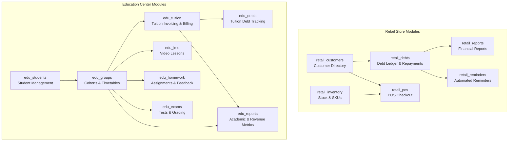

# IDROK AI — Modular Feature Management System

**Status:** Proposed Architecture  
**Author:** Principal Software Architect & Backend Lead  
**Scope:** Core Platform Module Activation & Entitlement Architecture  

---

## 1. Overview & Core Philosophy

IDROK AI is a universal business automation SaaS designed to serve fundamentally different business types (e.g. Retail Shops, Education Centers, Clinics, Hotels) without degrading into a fragmented collection of separate codebases.

To achieve this, IDROK AI employs a **Database-Controlled Modular Monolith Architecture**:
- All functional modules are implemented as registered, strongly typed Django applications in `backend/apps/modules/`.
- Every feature module is registered in a central database registry (`Module`).
- Business verticals (`BusinessType`) establish which modules are mandatory, default-enabled, or optional.
- Organizations receive an active entitlement record (`OrganizationModule`) that dictates runtime accessibility.
- **No Arbitrary Dynamic Code Execution:** Unlike vulnerable plugin systems that compile arbitrary third-party scripts, all code resides in the versioned repository. The database simply governs activation, authorization, and configuration.

---

## 2. The Golden Rules of Module Behavior

1. **Unique Immutable Identifiers:** Every module is referenced by an immutable, unique string code (e.g. `retail_debts`, `edu_tuition`). Code identifiers never change across migrations.
2. **Strict Backend Enforcement:** The backend is the single authority for module enforcement. Disabling a module in the UI is meaningless unless backed by DRF permission classes rejecting API operations with HTTP `403 Forbidden` (`MODULE_DISABLED`).
3. **Zero Data Destruction:** Deactivating a module **never** deletes tables, drops columns, or purges customer data. Disabling simply suspends read/write access and automated background workflows. Re-enabling the module instantly restores complete operational history.
4. **Dependency Integrity:** Modules may declare a prerequisite dependency (`depends_on`). A module cannot be enabled if its parent is disabled; a parent cannot be disabled while a child is active.
5. **Worker Safety:** Scheduled and asynchronous jobs (reminders, invoice generation, sync tasks) must verify that the relevant module is active for the target tenant before executing business actions.
6. **Immutable Audit Trails:** Every module state transition (enabled, disabled, reconfigured) must be recorded in `AuditLog` with the acting Super Admin ID and timestamp.

---

## 3. Module Catalog by Business Type



### 3.1 Retail Store Module Catalog

| Module Code | Module Name | Depends On | Default Status | Mandatory? | Description |
| --- | --- | --- | --- | --- | --- |
| `retail_customers` | Customer Directory | None | Enabled | Yes | Manage customer debtor profiles, phone numbers, and credit limits. |
| `retail_debts` | Debt Ledger ("Nasiya") | `retail_customers` | Enabled | Yes | Issue debts, record repayments, audit trail via immutable double-entry ledger. |
| `retail_inventory` | Inventory Management | None | Enabled | No | Product catalog, SKUs, barcode lookup, cost/sale prices, stock quantities. |
| `retail_pos` | Sales & POS Checkout | `retail_inventory`, `retail_customers` | Enabled | No | Cashier checkout counter, split payments (cash, card, debt). |
| `retail_reports` | Financial & Debt Reports | `retail_debts` | Enabled | No | Daily cashier collections, debt aging metrics, store revenue analysis. |
| `retail_reminders` | Debt Reminders | `retail_debts` | Disabled | No | Automated SMS / Task reminders for upcoming or overdue debt repayments. |

### 3.2 Education Center Module Catalog

| Module Code | Module Name | Depends On | Default Status | Mandatory? | Description |
| --- | --- | --- | --- | --- | --- |
| `edu_students` | Student Management | None | Enabled | Yes | Student profiles, parent contacts, admission dates, enrollment status. |
| `edu_groups` | Cohort & Group Management| `edu_students` | Enabled | Yes | Course cohorts, room allocations, instructor assignments, timetables. |
| `edu_tuition` | Tuition Billing & Payments| `edu_groups` | Enabled | Yes | Monthly tuition invoice generation, payment collection, discount plans. |
| `edu_debts` | Tuition Debt Tracking | `edu_tuition` | Enabled | Yes | Track overdue student tuition balances and family payment reconciliations. |
| `edu_lms` | Lessons & Video Content | `edu_groups` | Enabled | No | Video lessons, study materials, class syllabus distribution. |
| `edu_homework` | Homework & Grading | `edu_groups` | Enabled | No | Assignment distribution, file submissions, instructor grading and reviews. |
| `edu_exams` | Tests & Examinations | `edu_groups` | Disabled | No | Test/Quiz builder, student grade ranks, exam certifications. |
| `edu_reports` | Academic & Revenue Metrics| `edu_tuition` | Enabled | No | Student attendance rates, recurring monthly tuition revenue forecasts. |

---

## 4. Module Dependency Resolution Logic

To prevent broken operational states (such as recording a store debt without a customer module, or issuing homework without a group module), the system enforces strict dependency checks:

```python
# Module Activation Algorithm
def enable_module(organization, module, actor):
    # 1. Verify parent dependency
    if module.depends_on:
        parent_active = OrganizationModule.objects.filter(
            organization=organization,
            module=module.depends_on,
            is_enabled=True
        ).exists()
        if not parent_active:
            raise DependencyError(
                f"Cannot enable '{module.name}'. It requires '{module.depends_on.name}' to be active first."
            )

    # 2. Activate or create OrganizationModule
    entitlement, _ = OrganizationModule.objects.get_or_create(
        organization=organization,
        module=module,
        defaults={'is_enabled': True, 'activated_at': timezone.now()}
    )
    if not entitlement.is_enabled:
        entitlement.is_enabled = True
        entitlement.activated_at = timezone.now()
        entitlement.save(update_fields=['is_enabled', 'activated_at', 'updated_at'])

    # 3. Log Audit Event
    AuditLog.objects.create(
        organization=organization,
        actor=actor,
        action="MODULE_ENABLED",
        target_type="Module",
        target_id=module.id,
        details={"module_code": module.code, "module_name": module.name}
    )
```

```python
# Module Deactivation Algorithm
def disable_module(organization, module, actor):
    # 1. Prevent disabling mandatory modules
    mapping = BusinessTypeModule.objects.filter(
        business_type=organization.business_type,
        module=module
    ).first()
    if mapping and mapping.is_mandatory:
        raise ValidationError(f"Module '{module.name}' is mandatory for {organization.business_type.name}.")

    # 2. Check if active child modules depend on this module
    active_children = OrganizationModule.objects.filter(
        organization=organization,
        module__depends_on=module,
        is_enabled=True
    ).select_related('module')
    if active_children.exists():
        child_names = ", ".join([c.module.name for c in active_children])
        raise DependencyError(
            f"Cannot disable '{module.name}'. The following active modules depend on it: {child_names}."
        )

    # 3. Deactivate without dropping data
    entitlement = OrganizationModule.objects.get(organization=organization, module=module)
    entitlement.is_enabled = False
    entitlement.deactivated_at = timezone.now()
    entitlement.save(update_fields=['is_enabled', 'deactivated_at', 'updated_at'])

    # 4. Log Audit Event
    AuditLog.objects.create(
        organization=organization,
        actor=actor,
        action="MODULE_DISABLED",
        target_type="Module",
        target_id=module.id,
        details={"module_code": module.code, "module_name": module.name}
    )
```

---

## 5. Runtime Enforcement Pipeline

### 5.1 Backend DRF Permission Class
Every viewset or APIView residing in a feature module declares the `RequiresModule` permission:

```python
# backend/apps/common/permissions.py
from rest_framework import permissions
from rest_framework.exceptions import PermissionDenied

class RequiresModule(permissions.BasePermission):
    """
    Enforces that the target module is actively enabled for the requesting organization.
    Returns 403 Forbidden with a structured error payload if disabled.
    """
    def __init__(self, module_code: str):
        self.module_code = module_code

    def __call__(self):
        return self

    def has_permission(self, request, view):
        organization = getattr(request, 'organization', None)
        if not organization:
            return False

        # Platform Super Admins can inspect data if explicitly needed
        if getattr(request.user, 'is_platform_super_admin', False):
            return True

        is_enabled = OrganizationModule.objects.filter(
            organization=organization,
            module__code=self.module_code,
            is_enabled=True
        ).exists()

        if not is_enabled:
            raise PermissionDenied({
                "code": "MODULE_DISABLED",
                "message": f"Module '{self.module_code}' is not active for this organization.",
                "details": {"module": self.module_code}
            })

        return True
```

### 5.2 Frontend Dynamic Module Discovery
1. Upon organization selection in the Next.js Business Dashboard, the client requests:
   `GET /api/v1/organizations/{org_id}/modules`
2. The response returns an array of active module codes:
   ```json
   {
     "organization_id": "8a3e9c20-...",
     "business_type": "retail_store",
     "enabled_modules": [
       "retail_customers",
       "retail_debts",
       "retail_reports"
     ]
   }
   ```
3. The frontend sidebar navigation and dashboard routing dynamically hide links for modules not present in `enabled_modules`.
4. If a user attempts to manually navigate to `/inventory` or `/pos`, the client route guard redirects them to `/debts` with a notice that the feature is not active for their store.

---

## 6. Scheduled Job & Asynchronous Worker Policy

To prevent ghost tasks from running against suspended modules:
1. Every periodic Celery task or cron job queries tenant module state before executing mutations.
2. Example for automated debt reminders:
   ```python
   @shared_task
   def send_due_debt_reminders():
       # Select only organizations with retail_reminders AND retail_debts enabled
       active_org_ids = OrganizationModule.objects.filter(
           module__code='retail_reminders',
           is_enabled=True,
           organization__status='active'
       ).values_list('organization_id', flat=True)

       for org_id in active_org_ids:
           process_org_debt_reminders(org_id)
   ```
3. If an organization's `retail_reminders` module is toggled off, no background tasks will query debtor contact details or send external notifications.
