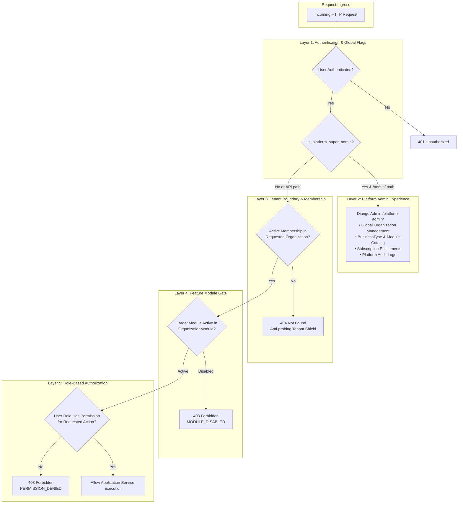

# IDROK AI — Roles & Permissions Specification

**Status:** Proposed Architecture  
**Scope:** Multi-Tenant Role-Based Access Control (RBAC) & Security Boundaries  

---

## 1. Security Architecture & Boundary Model

IDROK AI implements strict multi-tenant authorization governed by two independent security layers:
1. **Platform Administration Boundary (Django Admin):** Accessible strictly to users with `is_platform_super_admin=True`. Completely isolated from the tenant API and Next.js frontend.
2. **Tenant Scoped Authorization (DRF & Business Dashboard):** Every operational request requires an active `Membership` linking the authenticated `User` to the target `Organization`. Requests targeting resources outside the user's active membership return HTTP `404 Not Found` to prevent tenant probing.

---

## 2. Platform vs. Business Roles

### 2.1 Platform Scope

| Role | Interface | Responsibilities | Security Boundary |
| --- | --- | --- | --- |
| **Platform Super Admin** | Django Admin (`/admin/`) | Provision organizations, configure business types, register modules, manage subscription tiers, toggle tenant modules, view cross-tenant audit trails. | Must not participate in daily tenant POS/checkout transactions. Administrative access is audited in `AuditLog`. |

### 2.2 Business Scope (Per Organization)

| Role Code | Role Display Name | Applicable Business Types | Responsibilities |
| --- | --- | --- | --- |
| `org_owner` | Organization Owner | All (Retail, Education, etc.) | Full administrative authority over the business: manage staff memberships, view complete financial summaries, adjust store/school settings, export data. |
| `org_manager` | Organization Manager | All (Retail, Education, etc.) | Operational management: adjust customer credit limits, approve tuition waivers, manage cashier/teacher daily tasks, oversee shifts. |
| `cashier` | Cashier | Retail Store | Frontline counter operations: look up customer debt balances, record new sales/debts ("Nasiya"), accept debt repayments with receipts. Cannot alter credit limits. |
| `teacher` | Teacher / Instructor | Education Center | Classroom operations: view assigned group cohorts, upload video lesson links, create homework assignments, grade submissions, record attendance. |
| `accountant` | Accountant / Registrar | Education Center | Billing operations: generate monthly student tuition invoices, collect tuition payments, track overdue fee debts, view revenue reports. |
| `student` | Student (Future) | Education Center | Student portal: access assigned course materials, submit homework files, view graded test results and personal tuition balance. |

---

## 3. Detailed Permissions Matrix

### 3.1 Retail Store Operations

| Operational Capability | Platform Super Admin | Org Owner | Org Manager | Cashier |
| --- | :---: | :---: | :---: | :---: |
| Provision new Retail Store organization | **Yes** | No | No | No |
| Toggle Retail Modules (`retail_pos`, `inventory`) | **Yes** | Optional / Self-serve | No | No |
| Invite & remove store staff (Cashiers, Managers) | No | **Yes** | No | No |
| Create & edit customer profiles | No | **Yes** | **Yes** | **Yes** |
| Adjust customer credit limit | No | **Yes** | **Yes** | No |
| Issue store debt ("Nasiya savdo") | No | **Yes** | **Yes** | **Yes** |
| Record customer debt repayment | No | **Yes** | **Yes** | **Yes** |
| View customer debt ledger history | No | **Yes** | **Yes** | **Yes** |
| Access overall store financial reports | No | **Yes** | **Yes** | No |
| Reconcile cashier daily cash drawer | No | **Yes** | **Yes** | Own Shift |

### 3.2 Education Center Operations

| Operational Capability | Platform Super Admin | Org Owner | Org Manager | Teacher | Accountant |
| --- | :---: | :---: | :---: | :---: | :---: |
| Provision new Education Center organization | **Yes** | No | No | No | No |
| Toggle Education Modules (`edu_lms`, `exams`) | **Yes** | Optional | No | No | No |
| Manage teachers and administrative staff | No | **Yes** | No | No | No |
| Create student admission & parent contacts | No | **Yes** | **Yes** | No | **Yes** |
| Create study cohorts & assign classrooms | No | **Yes** | **Yes** | Assigned only| No |
| Generate monthly tuition invoices | No | **Yes** | **Yes** | No | **Yes** |
| Record student tuition fee payments | No | **Yes** | **Yes** | No | **Yes** |
| Grant tuition discounts or fee waivers | No | **Yes** | **Yes** | No | No |
| Publish video lessons & syllabus | No | **Yes** | **Yes** | **Yes** | No |
| Grade homework submissions & exams | No | **Yes** | **Yes** | **Yes** | No |
| Access academic & tuition revenue metrics | No | **Yes** | **Yes** | No | **Yes** |

---

## 4. Tenant Isolation and Security Guardrails

1. **Anti-Probing Tenant Shield:**
   - All tenant APIs use the path format `/api/v1/organizations/{organization_id}/...`.
   - If an authenticated user attempts to access an organization where they do not possess an active `Membership` (or if the organization does not exist), the response is strictly **HTTP 404 Not Found**.
   - HTTP 403 is never returned for foreign organizations, ensuring external attackers cannot enumerate valid organization IDs.
2. **Session and Cookie Security:**
   - Server-side sessions using Django sessions with `HttpOnly`, `SameSite=Lax`, and `Secure` (in HTTPS production).
   - Session keys rotate on login; logout invalidates the server session record immediately.
   - CSRF protection enforced on all mutating requests (`POST`, `PUT`, `PATCH`, `DELETE`) via `X-CSRFToken` headers.
3. **Double-Entry Financial Immutability:**
   - Cashiers and accountants cannot edit or delete completed `DebtLedger` or `TuitionLedger` entries. Corrections must be booked as new offsetting ledger adjustment transactions with manager/owner approval.
4. **Audit Logging Enforcement:**
   - All role adjustments, staff invitations, module toggles, credit limit overrides, and organization suspensions trigger an immediate synchronous write to `AuditLog`.
